# Chapter 3. 화면 구성 및 UI 둘러보기

CMW2026 프로그램을 처음 실행하면 아래와 같은 화면이 나타납니다. 이 장에서는 각 영역의 명칭과 역할을 상세히 설명합니다.

## 3.1 전체 레이아웃 개요

프로그램 화면은 크게 **상단 영역**, **왼쪽 패널**, **오른쪽 패널**의 3개 주요 구역으로 나뉩니다. 그 위에 프로그램 전체를 제어하는 **메뉴바**가 위치합니다. 아래는 프로그램 실행 직후의 전체 화면입니다.

<a href="../images/ch03/fig-3-0.png" target="_blank">
  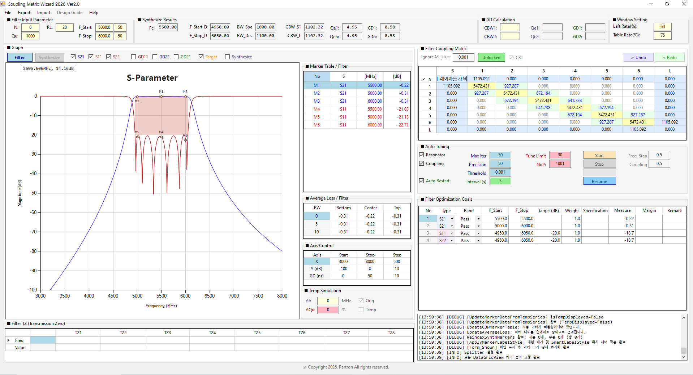
</a>

*그림 3-1: CMW2026 프로그램 초기 전체 화면 (클릭 시 확대)*

!!! tip "TIP"
    화면의 각 영역은 마우스 드래그로 크기를 조절할 수 있습니다. 특히 Window Setting에서 비율을 % 단위로 정밀하게 조정할 수 있습니다.

## 3.2 메뉴바 (Menu Bar)

프로그램 최상단의 메뉴바는 **프로젝트 관리**, **파일 입출력**, **도움말 접근**을 담당합니다. 화면 어디에서든 접근 가능하며, 대부분의 메뉴 항목은 단축키를 제공합니다.

*그림 3-2: 메뉴바 전체 구성 (File / Export / Import / Design Guide / Help)*

메뉴바는 5개의 메뉴로 구성됩니다.

### 3.2.1 File 메뉴

프로젝트 저장/열기 및 프로그램 종료를 담당합니다.

| 항목 | 단축키 | 기능 |
|------|--------|------|
| Save File | `Ctrl+S` | 현재 파일명으로 프로젝트 저장 (CSV) |
| Save As File | `Ctrl+Shift+S` | 다른 이름으로 프로젝트 저장 |
| Open File | `Ctrl+O` | 저장된 CSV 프로젝트 열기 |
| Clear All | - | 모든 데이터를 초기화하고 초기 실행 상태로 복귀 |
| Exit | - | 프로그램 종료 |

!!! warning "WARNING"
    **Clear All**은 모든 매트릭스, Goals, 마커, TZ 데이터를 초기화합니다. 실행 전 확인 대화상자가 표시되며, 이 작업은 되돌릴 수 없습니다.

상세 사용법은 [Chapter 9. 파일 입출력](ch09.md)을 참고하세요.

### 3.2.2 Export 메뉴

계산 결과와 그래프를 외부 파일로 내보냅니다.

| 항목 | 단축키 | 기능 |
|------|--------|------|
| Graph Image | `Ctrl+Shift+G` | 그래프와 마커 테이블을 이미지(PNG/JPG/BMP) + 정보 텍스트(.txt)로 저장 |
| Matrix | - | 커플링 매트릭스를 CSV로 내보내기 |
| Export Goals | - | Optimization Goals를 CSV로 내보내기 |
| K-Inverter | - | 커플링 값을 K-인버터(임피던스 인버터) 값으로 변환하여 CSV로 저장 |
| s2p File | - | S-파라미터를 Touchstone(.s2p) 포맷으로 내보내기 |
| Circuit Schematic | - | 커플링 매트릭스 기반 회로 개략도를 이미지로 저장 |

상세 사용법은 [Chapter 9. 파일 입출력](ch09.md)을 참고하세요.

### 3.2.3 Import 메뉴

외부 파일을 불러와 프로젝트에 반영합니다.

| 항목 | 기능 |
|------|------|
| Matrix | 커플링 매트릭스 CSV를 불러와 현재 프로젝트에 반영 |
| Import Mask | Optimization Goals(마스크)를 CSV로 불러오기 |
| sNp File | CST/HFSS 등에서 추출한 Touchstone(sNp) 파일을 불러와 커플링 매트릭스를 자동 추출 |

!!! tip "TIP"
    **sNp File** Import 시 포트 재배열(CST → CMW)이 자동으로 처리되며, Fi / Qe / M / CBW_S2 / CBW_Ln1이 자동 추출됩니다. 상세 내용은 [Chapter 9](ch09.md)를 참고하세요.

### 3.2.4 Design Guide 메뉴

필터 타입별 설계 가이드를 제공하는 메뉴입니다.

- **Cavity Filter Design**: 캐비티 공진기 기반 필터 설계 가이드
- **Mono Block Filter Design**: 모노블럭 세라믹 필터 설계 가이드
- **CWG Filter Design**: 원형 도파관 필터 설계 가이드

!!! note "NOTE"
    현재 버전에서는 **Design Guide 메뉴가 비활성화(회색 표시)** 상태입니다. 향후 버전에서 활성화될 예정입니다.

### 3.2.5 Help 메뉴

프로그램 정보 및 문서를 제공합니다.

| 항목 | 기능 |
|------|------|
| About | 프로그램 정보, 버전, 개발자, 기술 지원 연락처 |
| Filter Theory | Chebyshev 합성, S-파라미터 계산, TZ 이론 등 상세 이론 문서 |
| User Guide | 본 사용자 매뉴얼과 동일한 내용의 HTML 문서 |
| AI Design | AI를 활용한 프로그램 개발 가이드 |
| 🏗️ 프로젝트 구조 개요 | 소스 코드 파일 구조 및 역할 문서 |
| 🗺️ Roadmap | 향후 고도화 로드맵 문서 |

Help 메뉴의 각 항목은 별도의 대화상자로 표시되며, 대화상자 우측 하단의 **닫기 (Close)** 버튼으로 닫을 수 있습니다.

## 3.3 상단 영역 (Top Panels)

상단 영역은 프로그램의 핵심 파라미터를 입력하고, 합성된 결과를 한눈에 확인하는 곳입니다.

### 3.3.1 Filter Input Parameter (필터 입력 파라미터)

설계하고자 하는 필터의 기본 스펙을 입력하는 곳입니다.

- **N**: 필터 차수 (공진기 수). 높을수록 선택도가 좋아집니다.
- **RL**: 반사 손실(Return Loss, dB). 보통 15~25dB를 입력합니다.
- **Qu**: 무부하 Q (Unloaded Q). 재료의 손실 특성입니다.
- **F_Start / F_Stop**: 통과대역의 시작 및 종료 주파수 (MHz)입니다.
- **L_Guard / R_Guard**: 좌우 가드(Guard) 대역폭입니다.

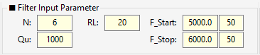

*그림 3-3: Filter Input Parameter 영역*

!!! warning "WARNING"
    값을 입력한 후 반드시 **Enter** 키를 눌러야 시스템에 확정됩니다. 마우스로 다른 곳을 클릭하면 값이 반영되지 않을 수 있습니다.

### 3.3.2 Synthesize Results (합성 결과)

입력된 파라미터를 바탕으로 Chebyshev 합성이 완료된 결과를 보여줍니다. (모두 읽기 전용)

- **Fc**: 기하 평균 중심 주파수
- **BW_Spec / BW_Design**: 스펙 대역폭 및 설계 대역폭 (Guard 포함)
- **CBW_S1 / CBW_Ln**: Source 및 Load의 커플링 대역폭
- **Qe1 / Qen**: 외부 Q 값
- **GD1 / GDn**: 입출력단의 Group Delay (ns)

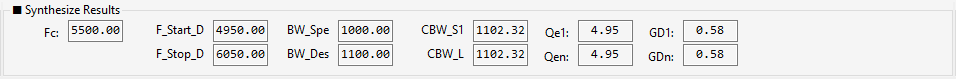

*그림 3-4: Synthesize Results 영역*

### 3.3.3 GD Calculation (독립 계산기)

간단한 계산기 기능입니다. CBW 값을 입력하면 현재 매트릭스를 건드리지 않고도 해당하는 Qe와 GD 값을 즉시 계산해 줍니다. (Enter 키로 계산)

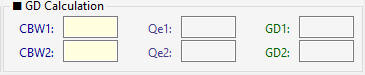

*그림 3-5: GD Calculation 영역*

### 3.3.4 Window Setting (화면 비율 조정)

- **Left Rate(%)**: 왼쪽 패널의 화면 비율을 조정합니다.
- **Table Rate(%)**: 오른쪽 그래프와 마커 테이블의 비율을 조정합니다.

<a href="../images/ch03/fig-3-4.png" target="_blank">
  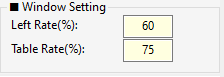
</a>

*그림 3-6: Window Setting 영역 (클릭 시 확대)*

## 3.4 왼쪽 패널 (Left Panel)

### 3.4.1 Filter Coupling Matrix (커플링 매트릭스)

필터의 물리적 결합 구조를 나타내는 가장 핵심적인 표입니다.

- 셀을 클릭하고 값을 입력하거나 **마우스 휠**을 굴려 값을 조정할 수 있습니다.
- **색상 범례**:
    - 🟨 **노란색 (대각선)**: 공진 주파수 (Fi)
    - 🟩 **연녹색 (대각선 인접)**: 주 커플링 (Main Coupling)
    - 🟦 **하늘색 (Source/Load)**: 외부 Q (Qe)
    - ⬜ **흰색 (그 외)**: 교차 커플링 (Cross Coupling)

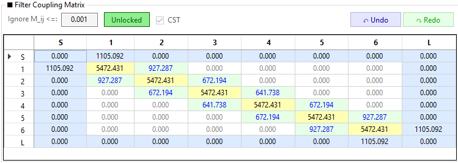

*그림 3-7: Filter Coupling Matrix 영역*

- **Unlocked/Locked 버튼**: 매트릭스 전체의 편집 가능 여부를 토글합니다. 특정 셀만 우클릭하여 개별 잠금(Lock) 처리할 수도 있습니다.
- **Ignore M_ij <=**: 이 값(기본 0.001) 미만의 커플링은 회색으로 표시되며, Auto Tuning 시 무시됩니다.
- **Undo / Redo**: 매트릭스 편집을 실행 취소(`Ctrl+Z`)하거나 다시 실행(`Ctrl+Y`)합니다. 최대 50단계까지 기억합니다.

### 3.4.2 Auto Tuning (자동 최적화)

매트릭스를 자동으로 튜닝하여 Optimization Goals(목표)를 만족시키는 알고리즘 설정 창입니다.

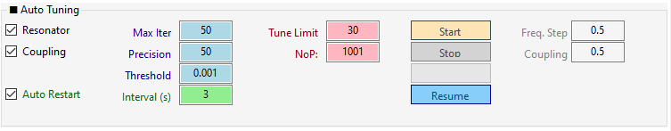

*그림 3-8: Auto Tuning 영역*

### 3.4.3 Optimization Goals (최적화 목표 마스크)

Auto Tuning이 달성해야 할 목표(마스크)를 정의합니다. Type(S11/S21/S22), Band(Pass/Stop), 주파수 범위, Target(dB), Weight 등을 설정합니다.

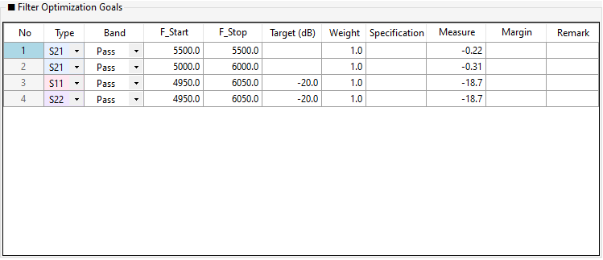

*그림 3-9: Optimization Goals 영역*

### 3.4.4 Log (로그)

프로그램의 모든 동작 로그가 시간순으로 표시됩니다. 각 로그는 `[HH:mm:ss] [레벨] 메시지` 형식으로 기록됩니다.

- **레벨**: INFO, DEBUG, WARNING, ERROR, SUCCESS
- **다중 선택**: `Ctrl` 또는 `Shift` 키로 여러 항목 선택 가능
- **복사**: `Ctrl+C` (선택 복사), `Ctrl+Shift+C` (전체 복사)
- **전체 선택**: `Ctrl+A`
- **로그 지우기**: 우클릭 → 로그 지우기

!!! tip "TIP"
    오류 발생 시 로그에서 `ERROR` 레벨 항목을 확인하면 원인 파악에 도움이 됩니다.

## 3.5 오른쪽 패널 (Right Panel)

### 3.5.1 Graph (S-Parameter 파형)

계산된 S-파라미터와 Group Delay가 시각화되는 차트입니다.

- **상단 버튼**: **Synthesizer** 모드(합성)와 **Filter** 모드(구현/튜닝)를 전환합니다.
- **체크박스**: S11, S21, S22 및 GD(Group Delay) 파형의 표시 여부를 제어합니다.
- **Overlay Synth (Filter 모드 전용)**: Filter 모드에서 체크 시 Synth 파형을 오버레이로 표시합니다. 파형 비교 목적으로 사용되며 Synth 마커는 표시되지 않습니다.

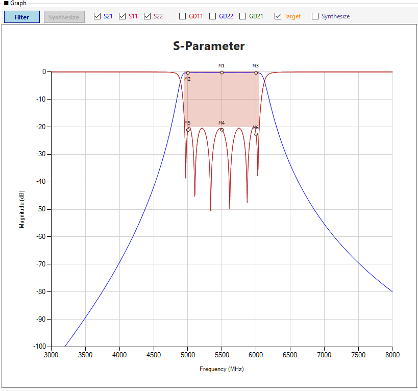

*그림 3-10: Graph 영역*

### 3.5.2 Filter TZ / Synthesize TZ (전송 영점 테이블)

- **Filter TZ**: CBW 모드에서 Cross-Coupling에 의해 파형에 나타나는 Notch(전송 영점)를 자동 검출하여 표시합니다. **표시 전용(읽기 전용)**이며 매트릭스와 직접 연동되지 않습니다.
- **Synthesize TZ**: Synthesize 모드에서 사용자가 직접 목표 TZ를 입력/편집하는 테이블입니다.

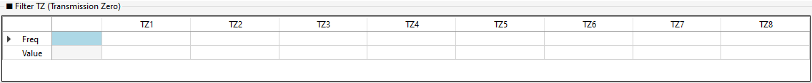

*그림 3-11: TZ 테이블 영역*

### 3.5.3 Marker Table (마커 리스트)

그래프에서 클릭하여 생성한 마커(수동 마커) 또는 Goals에 의해 자동 생성된 마커의 주파수와 측정값(Measure)을 리스트로 보여줍니다.

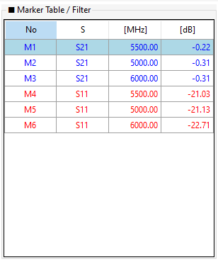

*그림 3-12: Marker Table 영역*

### 3.5.4 Axis Control (축 범위 제어)

그래프의 X축(주파수), Y축(dB), GD축(ns)의 시작(Start), 종료(Stop), 눈금 간격(Step)을 직접 입력하여 화면을 고정합니다.

<a href="../images/ch03/fig-3-11.png" target="_blank">
  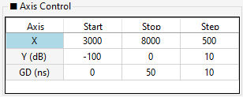
</a>

*그림 3-13: Axis Control 영역 (클릭 시 확대)*

### 3.5.5 Temp Simulation (온도 시뮬레이션)

온도 변화에 따른 주파수 이동(Δf)과 Q 저하(ΔQu)를 시뮬레이션합니다. 값을 입력하고 Enter를 누르면 점선 형태의 Temp 파형이 그래프에 추가됩니다.

<a href="../images/ch03/fig-3-12.png" target="_blank">
  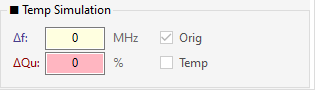
</a>

*그림 3-14: Temp Simulation 영역 (클릭 시 확대)*

### 3.5.6 Average Loss (평균 손실)

설정한 대역폭(BW) 구간 내에서의 평균 삽입 손실(Insertion Loss)을 Bottom, Center, Top 영역별로 계산하여 보여줍니다.

<a href="../images/ch03/fig-3-13.png" target="_blank">
  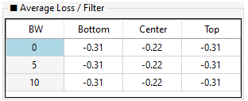
</a>

*그림 3-15: Average Loss 영역 (클릭 시 확대)*