# Chapter 4. Synthesize 모드 완전 정복

Synthesize 모드는 **Chebyshev 합성 이론**을 기반으로, 목표 스펙(Fc, BW, RL, TZ)에 완벽하게 일치하는 **이론적 이상 파형**을 생성하는 모드입니다.

실무적으로 Synthesize 모드는 **초기 고객의 요구 규격(Spec) 검토** 및 **최적의 필터 구조(공진기 단수, TZ 배치)를 결정**하는 가장 중요한 단계입니다. 이 장에서는 실무 관점의 설계 워크플로우를 상세히 다룹니다.

## 4.1 Synthesize 모드 진입 및 화면 구성

### 4.1.1 모드 진입
화면 우측 상단의 **Synthesizer** 버튼을 클릭합니다. 버튼 색상이 초록색으로 변하며 Synthesize 모드가 활성화됩니다.

### 4.1.2 주요 화면 변화
- 그래프에 `Synth S11`, `Synth S21`, `Synth S22` 파형이 표시됩니다.
- 오른쪽 하단의 **Synthesize TZ (Transmission Zero)** 테이블이 활성화됩니다.
- 왼쪽 Coupling Matrix 패널이 회색으로 비활성화됩니다. (Synthesize 모드는 매트릭스의 직접적인 영향을 받지 않습니다.)
- Auto Tuning 그룹박스가 활성화되며, RL과 TZ를 자동으로 최적화하는 모드로 동작합니다.

<a href="../images/ch04/fig-4-01.png" target="_blank">
  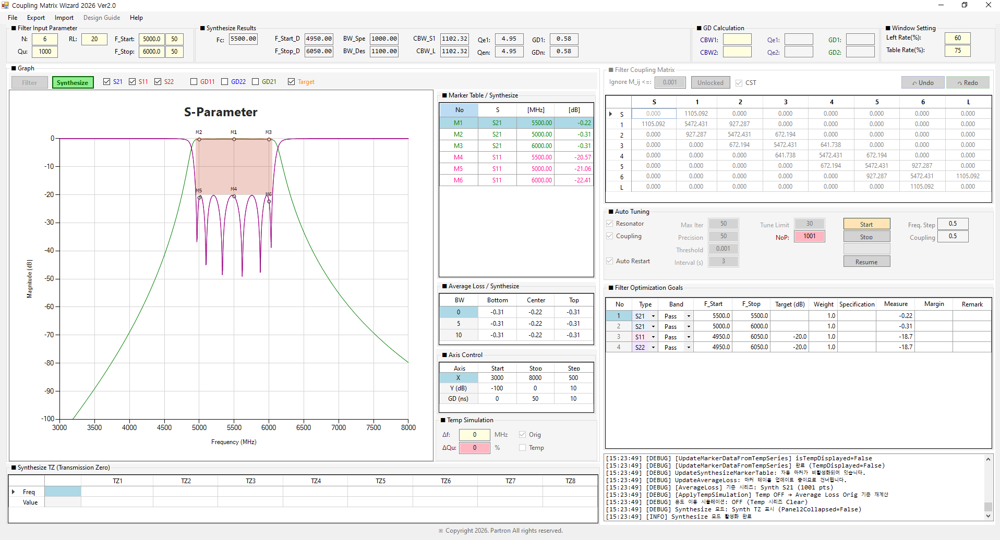
</a>

*그림 4-1: Synthesize 모드 진입 후 주요 화면 변화*

!!! note "NOTE"
    Synthesize 모드는 Coupling Matrix의 Fi, CBW, Qe 값을 **읽지도, 쓰지도 않습니다**. 순수하게 Chebyshev 해석적 합성(N, Fc, BW, RL, Qu, TZ)만으로 파형을 계산합니다.

## 4.2 고객 규격(Spec) 검토 및 Optimization Goals 설정

Synthesize 모드에 진입했다면, 가장 먼저 해야 할 일은 **고객이 요구한 마스크(Mask) 스펙을 Optimization Goals로 정의**하는 것입니다.

### 4.2.1 Optimization Goals 추가 방법 (3가지)

프로그램은 목표 스펙을 입력하는 3가지 방법을 제공합니다.

**방법 1: 그래프 우클릭을 통한 추가**

1. 그래프 빈 공간에서 마우스 우클릭을 합니다.
2. **Add Optimization Goals** 메뉴를 클릭합니다.
3. 작은 입력 창이 뜨면 Type(S11/S21/S22), Band(Pass/Stop), 주파수 범위, Target(dB)을 입력합니다.

<a href="../images/ch04/fig-4-02.png" target="_blank">
  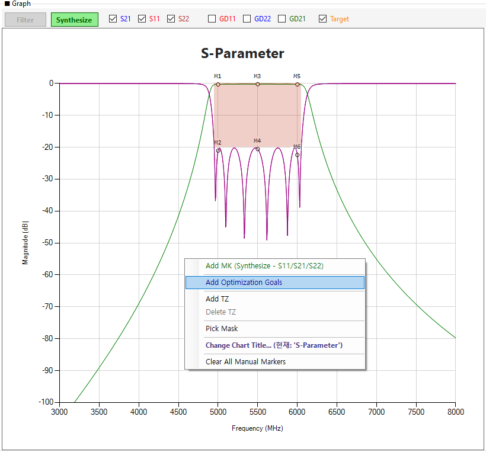
</a>

*그림 4-2: 그래프 우클릭을 통한 메뉴 선택*

<a href="../images/ch04/fig-4-03.png" target="_blank">
  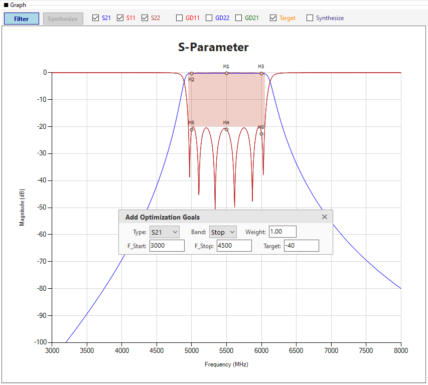
</a>

*그림 4-3: Goals 입력 팝업 창*

!!! tip "TIP"
    Goals 입력 창은 **모달리스(Modaless)** 로 동작합니다. 입력 창을 열어둔 채로 그래프나 다른 패널을 조작할 수 있으며, Enter 키로 Goals를 추가한 뒤에도 창이 닫히지 않아 **연속 입력**이 가능합니다.

**방법 2: Optimization Goals 그리드에 직접 추가**

1. 왼쪽 패널의 **Optimization Goals** 테이블로 이동합니다.
2. 빈 행을 클릭하여 Type, Band, F_Start, F_Stop, Target, Weight를 직접 입력합니다.
3. 테이블 우클릭 → **행 추가 (Insert Row)** 를 눌러 행을 늘릴 수도 있습니다.

<a href="../images/ch04/fig-4-04.png" target="_blank">
  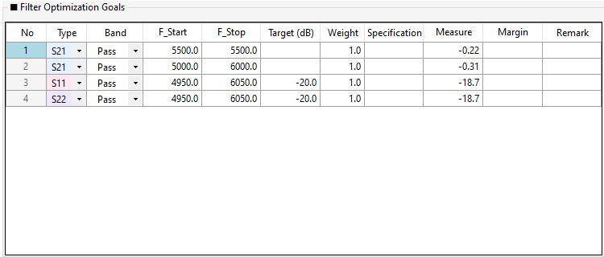
</a>

*그림 4-4: Optimization Goals 그리드 직접 입력*

<a href="../images/ch04/fig-4-05.png" target="_blank">
  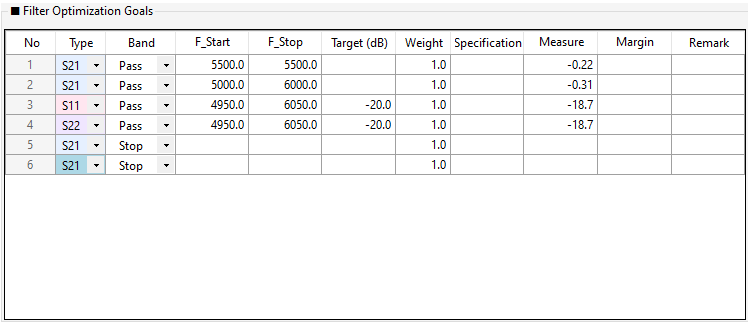
</a>

*그림 4-5: 우클릭을 통한 행 추가 메뉴*

**방법 3: Import Mask (CSV 파일 불러오기)**

1. 상단 메뉴에서 **Import → Import Mask**를 클릭합니다.
2. 고객으로부터 받은 스펙 CSV 파일을 선택하면 목표 마스크가 한 번에 로드됩니다.
3. 또는 Goals 테이블 우클릭 → **Import Mask (CSV)** 를 클릭해도 됩니다.

<a href="../images/ch04/fig-4-06.png" target="_blank">
  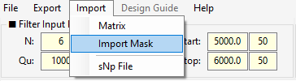
</a>

*그림 4-6: 상단 메뉴의 Import 경로*

<a href="../images/ch04/fig-4-07.png" target="_blank">
  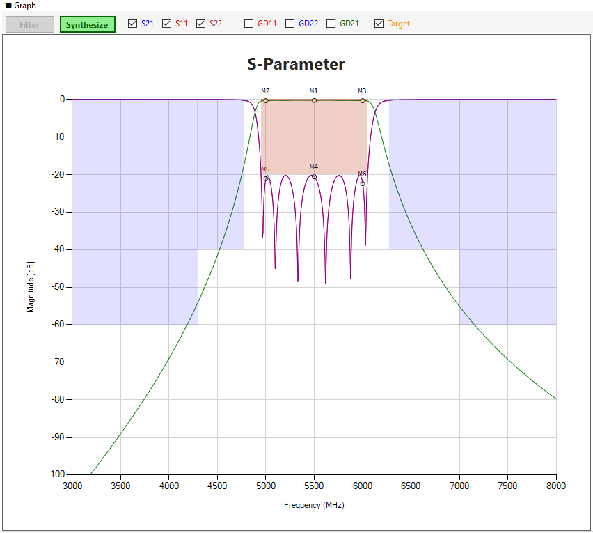
</a>

*그림 4-7: Import Mask 파일 열기 창*

!!! tip "TIP"
    Goals가 추가되면 그래프에 해칭(빗금) 영역으로 마스크가 표시됩니다. 이 마스크를 벗어나지 않도록 설계하는 것이 목표입니다.

## 4.3 TZ (Transmission Zero) 설계 및 조정

**"Filter의 최적 설계를 위해서는 반드시 TZ(전송 영점)를 추가해야 합니다."**
TZ는 특정 주파수의 신호를 차단하여 가파른 스커트 특성을 만들고, 결과적으로 더 적은 단수(N)로도 고객의 감쇠(Attenuation) 규격을 만족시킬 수 있게 해줍니다.

### 4.3.1 TZ 입력 방법

**방법 1: 마우스 우클릭을 통한 입력**

1. 그래프 빈 공간에서 마우스 우클릭을 하여 **Add TZ** 메뉴를 클릭합니다.

<a href="../images/ch04/fig-4-08.png" target="_blank">
  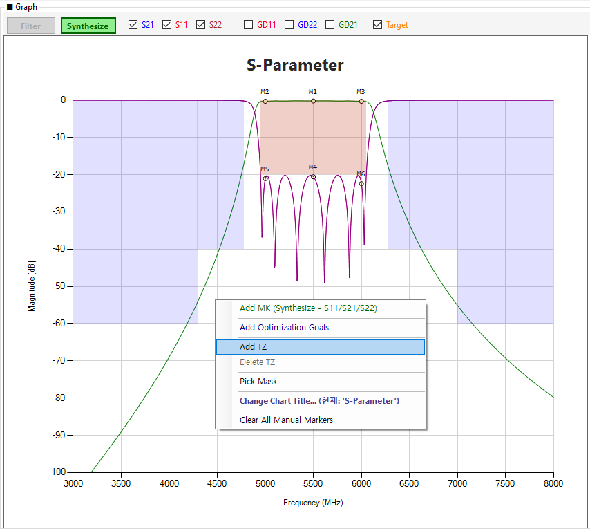
</a>

*그림 4-8: 그래프 우클릭(Add TZ) 메뉴 선택*

2. 주파수 입력 팝업창이 뜨면, 차단하고자 하는 주파수를 입력하고 `Enter`를 누릅니다.

<a href="../images/ch04/fig-4-09.png" target="_blank">
  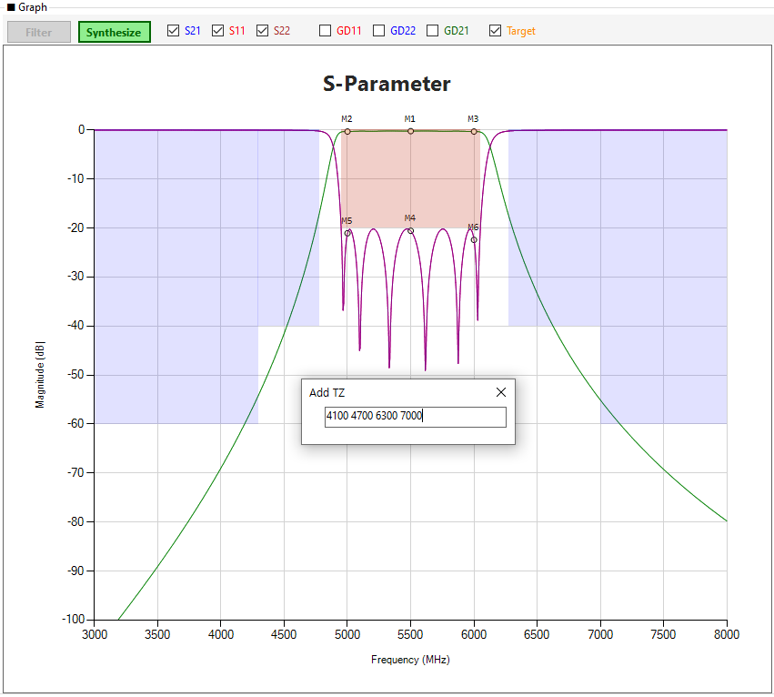
</a>

*그림 4-9: 주파수 입력 팝업창*

3. 팝업창이 닫히면 자동으로 S21 파형에 해당 주파수만큼 깊게 파이는 노치(Notch)가 생성되고, Synthesize TZ 테이블에 자동으로 등록됩니다.

<a href="../images/ch04/fig-4-10.png" target="_blank">
  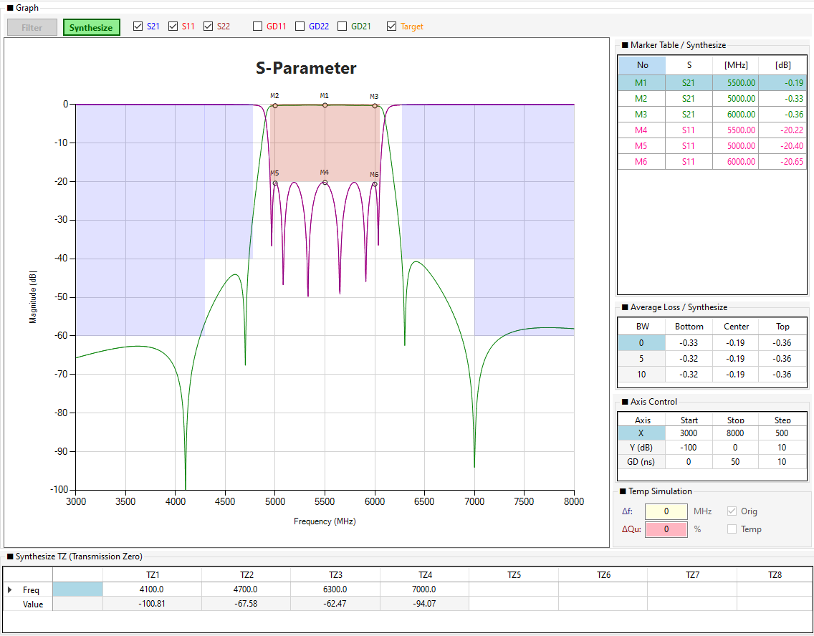
</a>

*그림 4-10: 그래프에 TZ가 추가된 결과 화면*

!!! tip "TIP"
    Add TZ 입력 팝업은 **모달리스**로 동작합니다. 팝업을 열어둔 상태에서도 그래프 마우스 좌표 표시 등 다른 UI 조작이 가능합니다. 여러 개의 TZ를 연속 추가하려면 `Enter` → 팝업 재호출을 반복하세요.

**방법 2: Synthesize TZ 테이블에서 직접 입력**

1. 우측 하단의 **Synthesize TZ** 테이블로 이동합니다.
2. 0행 `Freq (MHz)`의 원하는 열(예: TZ1)을 클릭합니다.
3. 주파수를 입력하고 `Enter`를 누릅니다.
4. 1행 `Value (dB)`에는 해당 주파수에서의 감쇠값이 자동으로 표시됩니다.

<a href="../images/ch04/fig-4-11.png" target="_blank">
  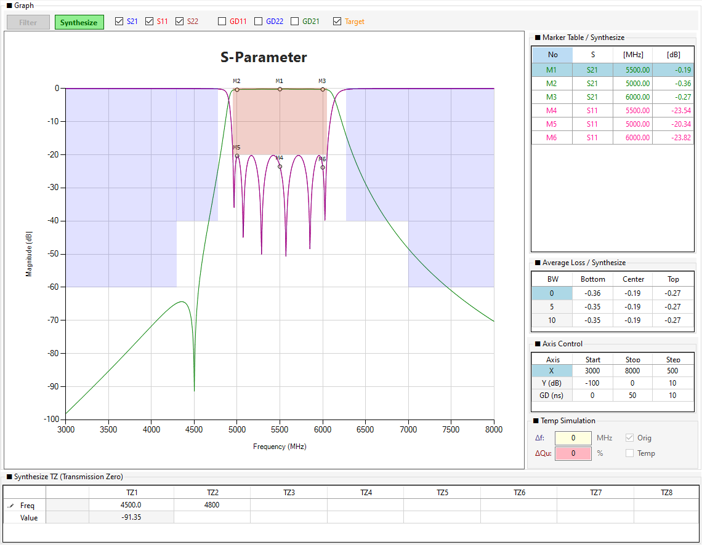
</a>

*그림 4-11: Synthesize TZ 테이블에서 직접 입력*

### 4.3.2 TZ 테이블 구조

Synthesize TZ 테이블은 **2행 구조**로 되어 있습니다.

| 행 | 헤더 | 설명 |
|----|------|------|
| 0행 | `Freq (MHz)` | TZ 주파수 (편집 가능, 0.5MHz 단위) |
| 1행 | `Value (dB)` | 해당 주파수에서의 S21 값 (읽기 전용, 자동 계산) |
| - | `Step` | 0행의 마우스 휠 조정 단위 (기본 0.5MHz) |

!!! note "NOTE"
    **Step 컬럼**은 TZ 주파수를 마우스 휠로 조정할 때의 증감 단위입니다. 0.5 (기본), 1.0, 0.1 등 원하는 단위로 변경할 수 있으며, 이 값은 0행에만 적용됩니다.

### 4.3.3 TZ 조정 방법

추가된 TZ를 미세 조정하여 최적의 위치를 찾는 방법입니다.

**방법 1: 테이블 수치 변경**
- TZ 테이블의 `Freq` 셀을 클릭하여 숫자를 직접 고치거나, 마우스 휠(Wheel)을 굴려 Step 컬럼에 설정된 단위로 조정합니다.

<a href="../images/ch04/fig-4-12.png" target="_blank">
  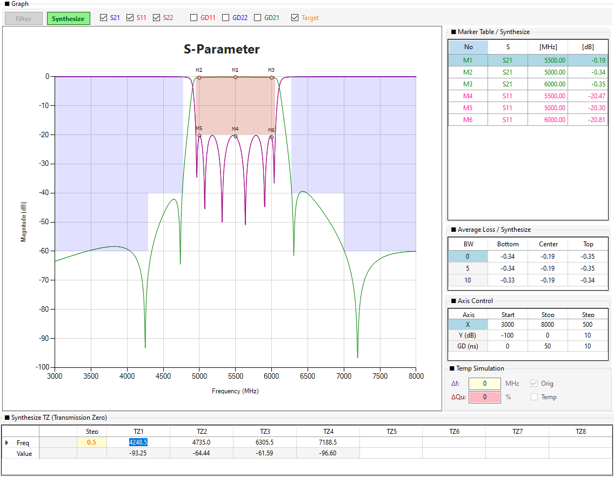
</a>

*그림 4-12: 테이블에서 수치 변경 및 마우스 휠 조정*

**방법 2: 그래프에서 드래그 (Drag & Drop)**

1. 그래프 상단 `S21` 체크박스가 켜져 있는지 확인합니다.
2. 그래프의 TZ 세로 가이드선 위에 마우스를 올립니다. (커서가 ↔ 로 바뀝니다.)
3. 클릭한 채로 좌우로 드래그합니다.
4. 드래그하는 동안 S21 파형이 실시간으로 재계산되어 따라 움직입니다.

<a href="../images/ch04/fig-4-13.png" target="_blank">
  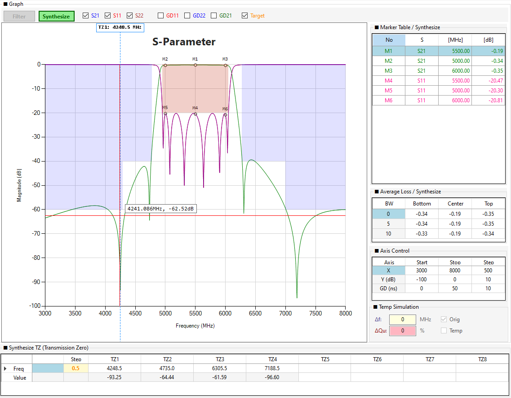
</a>

*그림 4-13: 그래프 상에서 마우스 드래그로 TZ 이동*

!!! warning "WARNING"
    TZ 드래그는 **세로 가이드선 위(허용 오차 4px)** 에서만 시작됩니다. 이는 TZ 근처에서 마커를 추가하려 할 때 드래그가 우선 시작되어 마커 추가가 차단되던 문제를 해결하기 위한 것입니다. 세로선에서 조금 벗어난 위치를 클릭하면 마커가 추가됩니다.

**방법 3: TZ 삭제 및 초기화**

- TZ 테이블에서 셀을 비우고 `Enter`를 치면 해당 TZ가 삭제됩니다.
- TZ 테이블 우클릭 → **선택한 TZ 삭제** 또는 **모든 TZ 삭제 (Clear All)** 를 눌러 초기화할 수 있습니다.
- 그래프 우클릭 → **Delete TZ** 메뉴로도 삭제 가능합니다. (마커 위에 있으면 해당 TZ, 아니면 커서에서 가장 가까운 TZ 삭제)

<a href="../images/ch04/fig-4-14.png" target="_blank">
  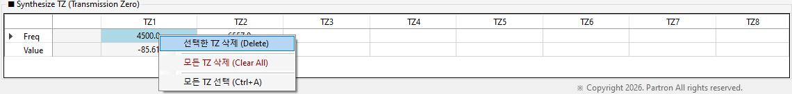
</a>

*그림 4-14: 우클릭 메뉴를 통한 TZ 삭제 및 초기화*

## 4.4 Synthesize 모드에서의 Auto Tuning (RL 및 TZ 자동 최적화)

Synthesize 모드에서의 Auto Tuning은 5장(Filter 모드)의 매트릭스 튜닝과 완전히 다르게 동작합니다.

!!! note "NOTE"
    Synthesize 모드의 Auto Tuning은 RL과 TZ를 최적화하는 반면, Filter 모드의 Auto Tuning은 매트릭스(Fi, CBW, Qe)를 최적화합니다.
    Filter 모드의 Auto Tuning 상세는 [Chapter 5.5](ch05.md#55-auto-tuning-filter-모드의-매트릭스-최적화)를 참조하세요.

### 4.4.1 최적화 원리

Synthesize 모드의 Auto Tuning은 **Coordinate Descent(교대 최적화)** 방식으로 동작합니다.

- **최적화 대상**: 오직 **RL(반사 손실)** 과 **TZ 주파수**입니다.
- **고정 대상**: N, Fc, BW, Qu는 고정됩니다. (특히 **Qu는 재료의 물성치**이므로 절대 변하지 않습니다.)
- **동작 방식**:
    1. **RL 최적화** (TZ 고정): Golden Section Search로 RL을 미세 조정
    2. **TZ 각각 최적화** (RL 고정): Golden Section Search로 각 TZ를 이동 (교차 방지 적용)
    3. 1~2를 반복 (최대 5회 또는 개선율 < 0.01%)
- **TZ 이동 범위**: 이전 TZ와 다음 TZ 사이 (최소 1MHz 간격 유지)에서 자유롭게 이동
- **결과 검증**: 최적화 후 S11/S22 페널티가 초기보다 10% 이상 악화되면 **자동으로 원본 복원**

### 4.4.2 튜닝 실행

1. 목표 마스크(Goals)와 TZ를 설정합니다.
2. Auto Tuning 그룹박스에서 **Start** 버튼을 클릭합니다.
3. 진행바(ProgressBar)가 채워지며, 최적화가 끝나면 TZ들이 최적의 위치로 이동해 있을 것입니다.

<a href="../images/ch04/fig-4-15.png" target="_blank">
  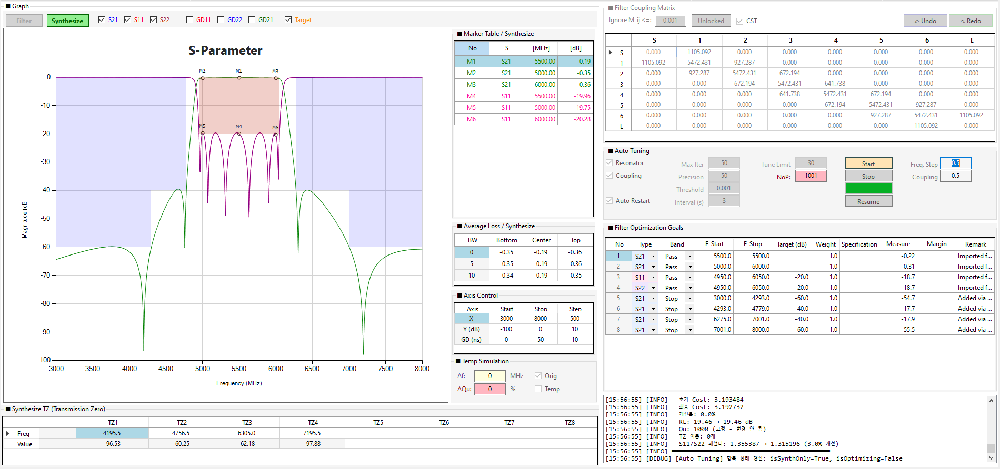
</a>

*그림 4-15: Auto Tuning을 통한 TZ 및 RL 최적화*

!!! warning "WARNING"
    Auto Tuning을 실행하면 현재 TZ 테이블의 값들이 Goals에 맞춰 스스로 이동합니다. 특정 TZ의 위치를 절대 고정하고 싶다면 튜닝 전에 해당 TZ를 Lock 하거나, 튜닝 후 값을 다시 조정해야 합니다.

!!! note "NOTE"
    Synthesize 모드의 Auto Tuning은 **Auto Restart 기능을 사용하지 않습니다**. Filter 모드의 Auto Restart(2초 간격 Resume)는 Synthesize 모드에서는 자동으로 비활성화됩니다. Synthesize 모드는 1회 실행으로 수렴하며, 결과가 만족스럽지 않으면 Start를 다시 클릭하세요.

### 4.4.3 결과 요약 로그

최적화 완료 시 로그에 다음과 같은 요약이 표시됩니다:

<!-- ★ 수정: 결과 검증 로직 보완 -->
**결과 검증 규칙**:

Synthesize 모드의 Auto Tuning은 **S11/S22 페널티**를 별도로 추적합니다. 최적화 후 S11/S22 페널티가 **초기보다 10% 이상 악화**되면 자동으로 **원본 값으로 복원**됩니다.

- **이유**: RL과 TZ 최적화가 S21 Goals만 만족시키고 S11/S22 반사 특성을 악화시키는 것을 방지
- **로그 확인**: "⚠ S11/S22가 악화되어 원본 값으로 복원합니다." 메시지 확인
- **복원 범위**: RL, TZ 모두 초기값으로 복원 (매트릭스는 영향 없음)

**로그 예시**:

!!! note "NOTE"
    Synthesize 모드 최적화는 **TZ와 RL만 조정**하며, **Qu는 절대 변경되지 않습니다** (재료 물성치). 매트릭스(Fi, CBW, Qe)도 전혀 영향을 받지 않습니다.