# Chapter 5. Filter(CBW) 모드 완전 정복

Filter 모드는 4장에서 합성된 이론적 파형을 바탕으로, 실제 **커플링 매트릭스(Coupling Matrix)** 를 조정하며 S-파라미터를 실시간으로 계산하는 모드입니다.

실무적으로 Filter 모드는 **합성된 이상 파형을 실제 물리 구조(캐비티, 도파관, 모노블럭 등)로 구현하기 위한 매트릭스 튜닝** 단계입니다. Optimization Goals를 정의하고, TZ를 추가한 뒤, Auto Tuning으로 매트릭스를 최적화하여 최종 설계를 확정합니다.

!!! note "NOTE"
    이 장에서는 매트릭스 편집, Goals, TZ, Auto Tuning, S-파라미터 검증, Average Loss, Axis Control을 다룹니다.
    **마커 설정은 [Chapter 6](ch06.md)**, **Temp Simulation은 [Chapter 7](ch07.md)**, **Export/Import 등 파일 입출력은 [Chapter 8](ch08.md)** 에서 상세히 설명합니다.

## 5.1 Filter 모드 개요

### 5.1.1 모드 진입

화면 우측 상단의 **Filter** 버튼을 클릭합니다. 버튼 색상이 파란색으로 변하며 Filter 모드가 활성화됩니다.

<a href="../images/ch05/fig-5-01.png" target="_blank">
  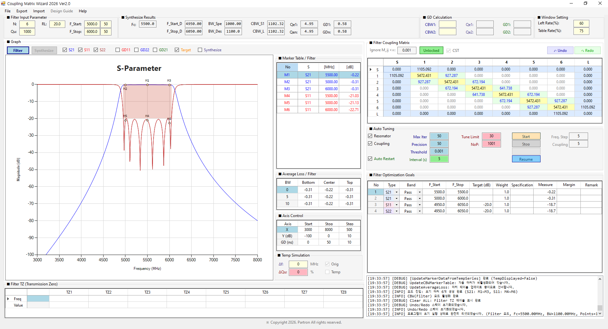
</a>

*그림 5-1: Filter 모드 진입 후 전체 화면*

### 5.1.2 주요 화면 변화

- 그래프에 `Tune S11`, `Tune S21`, `Tune S22` 파형이 표시됩니다.
- 왼쪽 Coupling Matrix 패널이 활성화되어 편집 가능합니다.
- 오른쪽 하단의 **Filter TZ** 테이블이 활성화됩니다. (Synthesize TZ 테이블은 숨겨짐)
- Average Loss 테이블이 활성화되어 통과대역 손실을 계산합니다.

### 5.1.3 Filter 모드와 Synthesize 모드의 근본적 차이

| 구분 | Synthesize 모드 | Filter(CBW) 모드 |
|------|----------------|-------------------|
| 계산 방식 | Chebyshev 해석적 합성 | 매트릭스 기반 행렬 방정식 (A·x = b) |
| 입력 파라미터 | N, Fc, BW, RL, Qu, TZ | 매트릭스(Fi, CBW, Qe) + Qu |
| Coupling Matrix | 읽지도 쓰지도 않음 | 편집 및 실시간 반영 |
| Auto Tuning 대상 | RL, TZ | Fi, CBW, Qe (매트릭스 값) |
| Temp Simulation | 합성 파라미터에 Δf/ΔQu 적용 | 매트릭스에 Δf/ΔQu 적용 |
| TZ 테이블 | Synthesize TZ (편집) | Filter TZ (표시 전용) |

!!! note "NOTE"
    Filter 모드는 Coupling Matrix의 **Fi, CBW, Qe** 값을 기반으로 S-파라미터를 계산합니다. 따라서 매트릭스를 편집하면 파형이 즉시 바뀝니다.

### 5.1.4 Filter 모드 워크플로우 개요

Filter 모드의 표준 워크플로우는 다음과 같습니다.

1. **매트릭스 초기값 확인** → 5.2
2. **Optimization Goals 정의** → 5.3
3. **TZ(Transmission Zero) 추가** → 5.4
4. **Auto Tuning으로 매트릭스 최적화** → 5.5
5. **S-파라미터 실시간 검증** → 5.6
6. **Average Loss 분석** → 5.7
7. **Axis Control** → 5.8
8. **Export** → [Chapter 8](ch08.md)

## 5.2 Filter Coupling Matrix 이해 및 편집

### 5.2.1 매트릭스 구조

Filter Coupling Matrix는 **(N+2) × (N+2)** 크기의 대칭 행렬입니다. N은 공진기 수입니다.

- **0행/0열**: Source 포트 (S)
- **1~N행/열**: 공진기 1~N
- **N+1행/열**: Load 포트 (L)

<a href="../images/ch05/fig-5-02.png" target="_blank">
  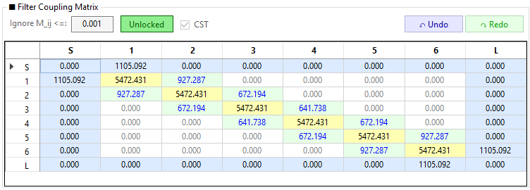
</a>

*그림 5-2: Coupling Matrix 전체 구조*

### 5.2.2 셀의 종류와 색상 의미

| 위치 | 색상 | 의미 | 값의 단위 |
|------|------|------|----------|
| 대각선 (i,i) | 🟨 노란색 | 공진 주파수 (Fi) | MHz |
| 대각선 인접 (i,i+1) | 🟩 연녹색 | 주 커플링 (Main Coupling, CBW) | MHz |
| Source/Load 인접 (0,1)/(N,N+1) | 🟦 하늘색 | 외부 Q (Qe) → CBW로 표시 | MHz |
| 그 외 (Cross Coupling) | ⬜ 흰색 | 교차 커플링 (CBW) | MHz |
| Lock된 셀 | 🟧 엷은 주황 | 편집 차단 | - |
| Ignore된 셀 (임계값 미만) | ⬜ 흰색 (회색 글자) | Auto Tuning에서 제외 | - |

!!! note "NOTE"
    매트릭스에 표시되는 값은 **CBW(Coupling Bandwidth, MHz)** 단위입니다. Qe 값은 `Qe = BW × Fc / CBW²` 로 내부 변환되어 계산됩니다.

### 5.2.3 매트릭스 셀 편집

**방법 1: 직접 입력**

1. 셀을 클릭합니다.
2. 값을 입력하고 `Enter` 키를 누릅니다.
3. 대칭 셀(예: (1,2)와 (2,1))에 자동으로 동일한 값이 반영됩니다.

<a href="../images/ch05/fig-5-03.png" target="_blank">
  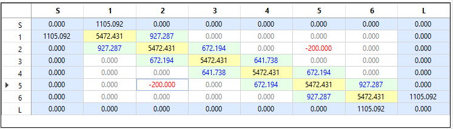
</a>

*그림 5-3: 매트릭스 셀 직접 입력*

**방법 2: 마우스 휠 조정**

1. 셀을 클릭합니다.
2. 마우스 휠을 위/아래로 굴립니다.
3. Auto Tuning 그룹의 **Freq. Step** (Fi 셀) 또는 **Coupling Step** (CBW 셀) 값만큼 증감합니다.

<a href="../images/ch05/fig-5-04.png" target="_blank">
  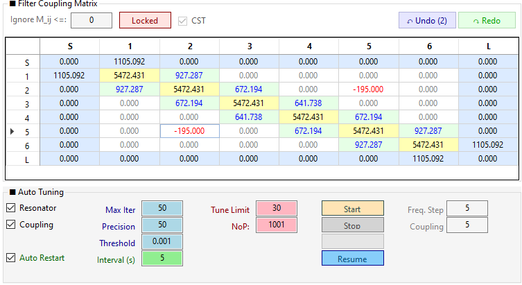
</a>

*그림 5-4: 마우스 휠로 셀 값 조정*

!!! note "NOTE"
    **Freq. Step**과 **Coupling Step**은 이 **수동 튜닝(마우스 휠)에만 사용**됩니다. Auto Tuning 실행 중에는 이 값들이 사용되지 않으며, Auto Tuning은 내부 알고리즘이 자체 조정 스텝을 결정합니다. Auto Tuning 후 미세 조정이 필요할 때 이 값을 낮추고 휠을 굴리면 정밀한 조정이 가능합니다.

**방법 3: 실시간 파형 확인**

셀 값을 변경하면 우측 그래프의 S11/S21/S22 파형이 실시간으로 갱신됩니다.

<a href="../images/ch05/fig-5-05.png" target="_blank">
  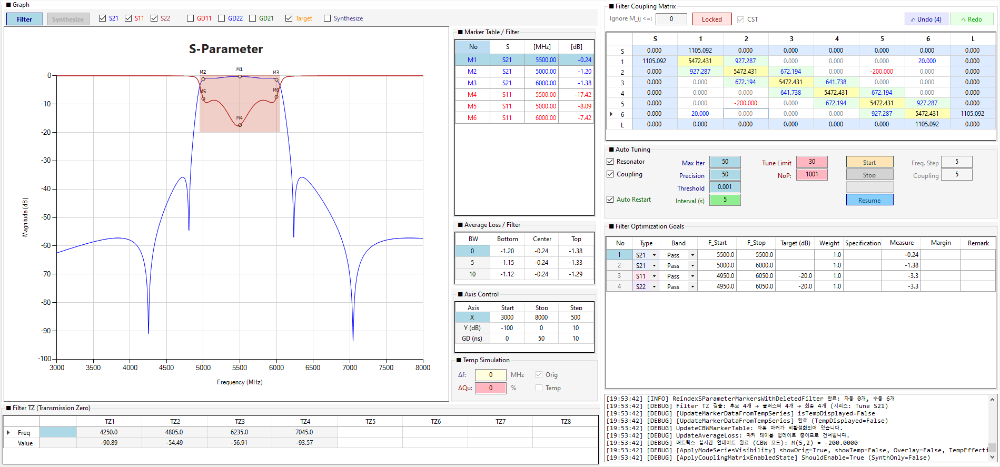
</a>

*그림 5-5: 매트릭스 편집 후 파형 실시간 갱신*

### 5.2.4 Lock / Unlock

특정 셀을 **잠금(Lock)** 하여 Auto Tuning 중에도 값이 변하지 않도록 보호할 수 있습니다.

**개별 셀 Lock**

1. 잠그려는 셀을 **우클릭**합니다.
2. **Toggle Lock / Unlock Cell** 메뉴를 클릭합니다.
3. 셀이 엷은 주황색 배경으로 바뀌며 Lock 상태가 됩니다.

<a href="../images/ch05/fig-5-06.png" target="_blank">
  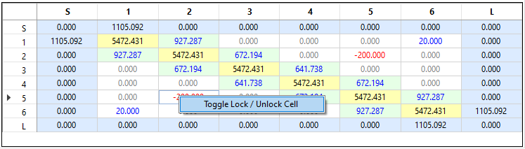
</a>

*그림 5-6: 우클릭을 통한 Lock/Unlock 메뉴*

<a href="../images/ch05/fig-5-07.png" target="_blank">
  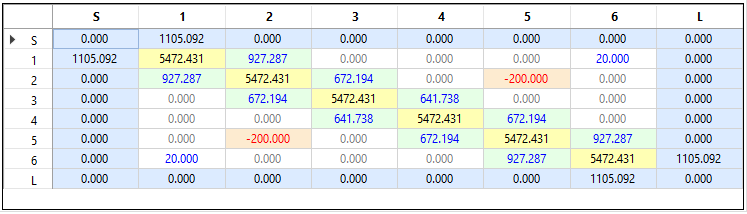
</a>

*그림 5-7: Lock된 셀 (엷은 주황색 배경)*

**전체 Lock/Unlock 토글**

매트릭스 상단 툴바의 **Unlocked** / **Locked** 버튼을 클릭하면 전체 Lock 상태가 토글됩니다.

<a href="../images/ch05/fig-5-08.png" target="_blank">
  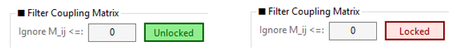
</a>

*그림 5-8: 매트릭스 상단 툴바 (Ignore, Unlock, CST, Undo, Redo)*

### 5.2.5 Ignore M_ij (임계값)

매트릭스 상단의 **Ignore M_ij <=** 입력란(기본값 `0.001`)은 **Auto Tuning에서 무시할 커플링의 임계값**입니다.

- 값이 `0.001` 미만인 셀은 흰색 배경 + **회색 글자**로 표시됩니다.
- Auto Tuning 시 이 셀들은 **튜닝 대상에서 제외**됩니다.

<a href="../images/ch05/fig-5-09.png" target="_blank">
  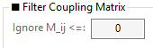
</a>

*그림 5-9: Ignore 임계값 미만 셀의 회색 표시*

### 5.2.6 Undo / Redo

매트릭스 편집 중 실수했다면 `Ctrl+Z`(Undo) 또는 `Ctrl+Y`(Redo)를 사용하세요.

- **최대 50단계**까지 기억합니다.
- 매트릭스 편집에만 적용됩니다.
- Undo/Redo 스택은 `Clear All` 또는 파일 로드 시 초기화됩니다.

## 5.3 Optimization Goals (최적화 목표) 입력

Auto Tuning을 실행하기 전에 **달성해야 할 목표(마스크)** 를 Optimization Goals 테이블에 정의해야 합니다. Goals가 없으면 Auto Tuning이 실행되지 않습니다.

### 5.3.1 Optimization Goals 테이블 구조

왼쪽 패널의 **Optimization Goals** 그리드는 다음 열로 구성됩니다.

| 열 | 설명 |
|----|------|
| **No** | 목표 번호 (자동) |
| **Type** | S11 / S21 / S22 |
| **Band** | Pass / Stop |
| **F_Start / F_Stop** | 목표 주파수 범위 (MHz) |
| **Target** | 목표 감쇠/이득 (dB) |
| **Weight** | 가중치 (기본 1.00) |
| **Specification** | 사용자 메모용 스펙 |
| **Measure** | 현재 파형 측정값 (자동 계산) |
| **Margin** | Spec − Measure 차이 (자동 계산, ≥0 청색, <0 적색) |
| **Remark** | 비고 |

<a href="../images/ch05/fig-5-10.png" target="_blank">
  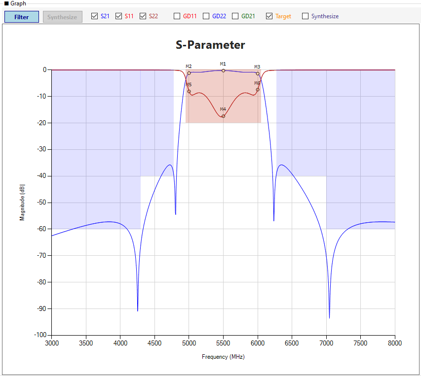
</a>

*그림 5-10: Optimization Goals 그리드 (예시 데이터)*

!!! note "NOTE"
    프로그램 시작 시 **1~4행이 자동 생성**됩니다 (S21 Pass × 2, S11 Pass, S22 Pass). Filter Input Parameter를 변경하면 1~4행이 자동 갱신됩니다. 자동 마커가 비활성화되어 있어도 Goals는 Auto Tuning에 그대로 사용됩니다.

### 5.3.2 Goals 추가 방법 (3가지)

**방법 1: 그래프 우클릭 → Add Optimization Goals**

1. 그래프 빈 공간에서 **우클릭**합니다.
2. **Add Optimization Goals** 메뉴를 클릭합니다.
3. 입력 팝업에서 Type, Band, F_Start, F_Stop, Target, Weight를 입력하고 `Enter`를 누릅니다.

<a href="../images/ch05/fig-5-11.png" target="_blank">
  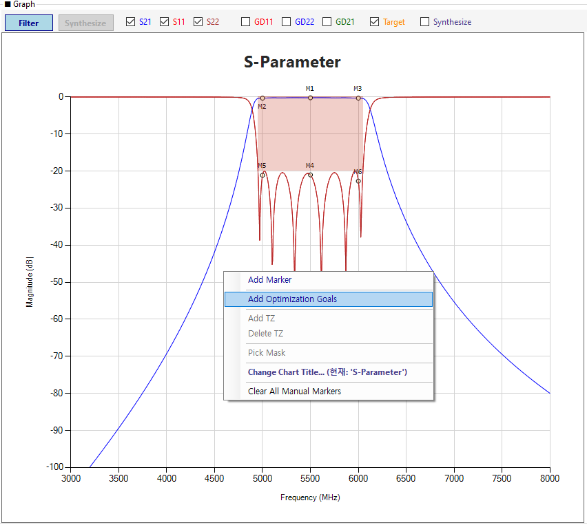
</a>

*그림 5-11: 그래프 우클릭 → Add Optimization Goals*

<a href="../images/ch05/fig-5-12.png" target="_blank">
  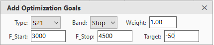
</a>

*그림 5-12: Add Optimization Goals 입력 팝업*

!!! tip "TIP"
    입력 팝업은 **모달리스(Modaless)** 로 동작합니다. Enter로 Goals를 추가한 뒤에도 창이 닫히지 않아 연속 입력이 가능합니다. `ESC` 키로 닫을 수 있습니다.

**방법 2: Goals 그리드에 직접 입력**

1. Goals 그리드의 빈 행을 클릭합니다.
2. Type, Band, F_Start, F_Stop, Target, Weight를 직접 입력합니다.
3. 그리드 우클릭 → **행 추가 (Insert Row)** 로 행을 늘릴 수도 있습니다.
4. 행 삭제는 우클릭 → **선택한 행 삭제** 또는 `Delete` 키.

**방법 3: Import Mask (CSV 파일 불러오기)**

1. 상단 메뉴에서 **Import → Import Mask**를 클릭합니다.
2. 고객으로부터 받은 스펙 CSV 파일을 선택합니다.
3. 또는 Goals 그리드 우클릭 → **Import Mask (CSV)** 를 클릭해도 됩니다.

<a href="../images/ch05/fig-5-13.png" target="_blank">
  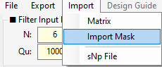
</a>

*그림 5-13: Import Mask 파일 선택 창*

### 5.3.3 Goals 입력 규칙

- **Target**: S21 Pass는 **음수** (예: -1.0 dB), S11/S22 Pass는 **음수** (예: -20 dB), Stop Band는 **음수** (예: -40 dB)
- **F_Start = F_Stop**: 단일 주파수 목표 (해당 지점 값만 검사)
- **Weight**: 우선순위 가중치. 특정 구간을 더 중요하게 하려면 2.0, 5.0 등으로 증가
- **Band**: `Pass`는 통과대역 목표, `Stop`은 저지대역 목표

### 5.3.4 Goals 마스크 시각화

Goals가 추가되면 그래프에 **해칭(빗금) 영역**으로 마스크가 표시됩니다. 이 마스크를 벗어나지 않도록 매트릭스를 튜닝하는 것이 목표입니다.

<a href="../images/ch05/fig-5-14.png" target="_blank">
  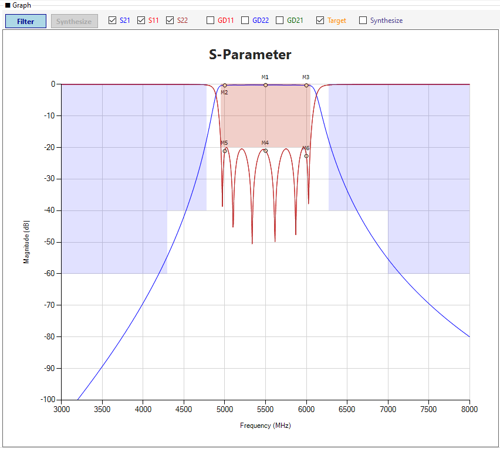
</a>

*그림 5-14: Goals 마스크가 해칭으로 표시된 그래프*

## 5.4 TZ (Transmission Zero) 추가

**"Filter의 최적 설계를 위해서는 반드시 TZ(전송 영점)를 추가해야 합니다."**

TZ는 특정 주파수의 신호를 차단하여 가파른 스커트 특성을 만들고, 결과적으로 더 적은 단수(N)로도 고객의 감쇠(Attenuation) 규격을 만족시킬 수 있게 해줍니다.

Filter 모드에서 TZ는 **Cross-Coupling(교차 커플링)** 에 의해 생성됩니다. 따라서 TZ를 추가한다는 것은 **매트릭스의 Cross-Coupling 셀에 값을 입력**하는 것과 같습니다.

<!-- ★ 수정: Filter TZ는 표시 전용 강조 -->
### 5.4.1 TZ 추가 방법 개요

Filter 모드에서 TZ를 다루는 방법은 다음과 같습니다.

| 방법 | 지원 여부 | 설명 |
|------|----------|------|
| **① 매트릭스 Cross-Coupling 직접 입력** | ✅ 지원 | 가장 근본적이고 물리적으로 정확한 방법 |
| **② 매트릭스 셀 마우스 휠 조정** | ✅ 지원 | Cross-Coupling 값 미세 조정 |
| **③ Filter TZ 테이블 참조** | ✅ 지원 (읽기 전용) | 자동 검출된 TZ 확인 |
| **④ 그래프 우클릭 → Add TZ** | ❌ **미지원** | Synthesize 모드 전용 기능입니다 |
| **⑤ 그래프 드래그** | ❌ **미지원** | Synthesize 모드 전용 기능입니다 |

!!! warning "WARNING"
    **Filter 모드에서는 그래프 상에서 TZ를 직접 추가하거나 드래그로 이동할 수 없습니다.** TZ는 오직 **매트릭스의 Cross-Coupling 값을 통해서만** 생성/조정됩니다. 그래프 우클릭의 "Add TZ" 메뉴와 TZ 드래그는 **Synthesize 모드 전용** 기능입니다.

### 5.4.2 방법 ①: 매트릭스 Cross-Coupling 직접 입력

가장 근본적이고 물리적으로 정확한 방법입니다.

**동작 원리**:
- 공진기 i와 j(i, j ≥ 1, |i-j| ≥ 2) 사이의 Cross-Coupling M(i,j)는 S21 파형에 TZ를 생성합니다.
- 예: M(2,5) → 통상 TZ 2개, M(1,6) → 통상 TZ 2개 (단, 실제 개수/위치는 Goals 및 다른 파라미터에 따라 달라질 수 있음)
- **M(i,j) 값의 크기가 클수록 TZ가 통과대역에 가깝게** 이동하는 경향이 있습니다.
- **부호(+, -)에 따라 TZ의 좌우 위치가 달라집니다.**

<!-- ★ 수정: 예시가 "시연용"임을 강조 -->
!!! note "NOTE"
    아래 실습 예시의 `-200`, `20`은 TZ 생성을 시연하기 위한 **값**입니다. 실제 TZ 개수와 위치는 매트릭스 전체 구조, Fc, BW, RL, Qu에 따라 달라지며, Filter TZ 테이블에 자동 검출된 결과를 기준으로 판단해야 합니다.

**실습 예시**:

다음 두 Cross-Coupling을 순차적으로 입력하여 S21 파형에 **다중 TZ**가 생성되는 과정을 확인합니다.

**1단계: (2,5)에 -200 입력**

1. 매트릭스에서 **(2,5) 셀**을 클릭합니다.
2. 값 **`-200`** 을 입력하고 `Enter`를 누릅니다.
3. S21 파형이 재계산되며, (2,5) Cross-Coupling에 의한 TZ가 생성됩니다.

<a href="../images/ch05/fig-5-15.png" target="_blank">
  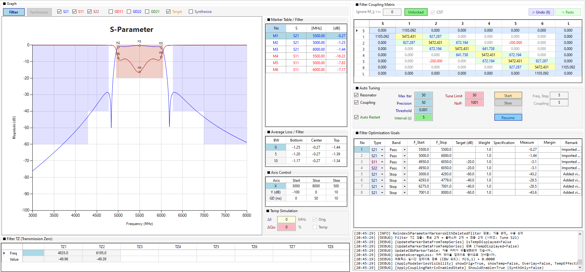
</a>

*그림 5-15: (2,5) Cross-Coupling에 -200 입력*

**2단계: (1,6)에 20 추가 입력**

1. 이어서 매트릭스에서 **(1,6) 셀**을 클릭합니다.
2. 값 **`20`** 을 입력하고 `Enter`를 누릅니다.
3. S21 파형이 재계산되며, (2,5)에 의한 TZ에 더해 (1,6) Cross-Coupling에 의한 TZ가 추가됩니다.

<a href="../images/ch05/fig-5-16.png" target="_blank">
  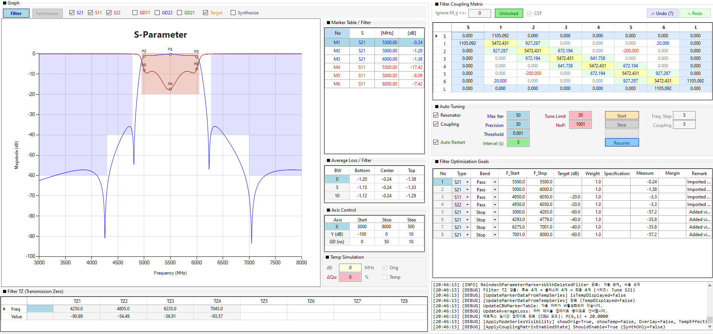
</a>

*그림 5-16: (2,5)=-200 및 (1,6)=20 동시 입력 결과*

!!! tip "TIP"
    Cross-Coupling 셀에 값을 입력하면 **대칭 셀(예: (5,2), (6,1))** 에도 자동으로 동일한 값이 반영됩니다. 이는 매트릭스가 대칭 행렬이기 때문입니다.

!!! warning "WARNING"
    Cross-Coupling 값이 **너무 크면 TZ가 통과대역 안으로 들어와** 삽입 손실이 급격히 악화될 수 있습니다. 실제 설계에서는 Goals 마스크와 Average Loss를 확인하며 값을 조정하세요.

### 5.4.3 방법 ②: 매트릭스 셀 마우스 휠 조정

5.4.2에서 설정한 Cross-Coupling 값의 위치를 **마우스 휠로 미세 조정**하여 원하는 주파수로 이동시킬 수 있습니다.

**실습 절차**:

1. 5.4.2의 1단계에서 입력한 **(2,5) 셀**을 클릭합니다.
2. 마우스 휠을 위/아래로 굴립니다.
3. **Coupling Step** (기본 5 MHz) 단위로 값이 증감하며, TZ가 실시간으로 이동합니다.
4. TZ의 위치 변화는 S21 파형과 Filter TZ 테이블에서 동시에 확인할 수 있습니다.

<a href="../images/ch05/fig-5-17.png" target="_blank">
  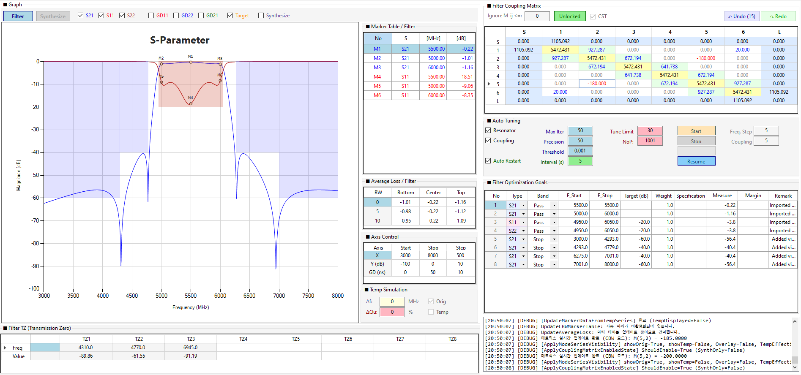
</a>

*그림 5-17: (2,5) Cross-Coupling을 마우스 휠로 조정하여 TZ 위치 이동*

!!! tip "TIP"
    Coupling Step이 5 MHz로 클 경우 TZ가 한 번에 크게 이동합니다. 더 세밀한 조정이 필요하면 Auto Tuning 그룹의 **Coupling Step** 값을 1 또는 0.5로 낮추고 다시 휠을 굴리세요. (이 값은 수동 휠 조정 전용이며, Auto Tuning에는 영향을 주지 않습니다.)

### 5.4.4 방법 ③: Filter TZ 테이블 참조

TZ가 추가되면 우측 하단의 **Filter TZ** 테이블에 자동으로 표시됩니다.

| 행 | 헤더 | 설명 |
|----|------|------|
| 0행 | `Freq (MHz)` | 검출된 TZ 주파수 (읽기 전용) |
| 1행 | `Value (dB)` | 해당 주파수에서의 S21 값 (읽기 전용) |

<a href="../images/ch05/fig-5-18.png" target="_blank">
  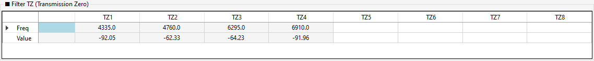
</a>

*그림 5-18: Filter TZ 테이블 (자동 표시)*

!!! warning "WARNING"
    Filter TZ 테이블은 **표시 전용(읽기 전용)** 입니다. 테이블의 값을 수정하여 매트릭스나 파형을 변경할 수 없습니다. TZ를 직접 조정하려면 매트릭스의 Cross-Coupling 값을 변경하세요.

### 5.4.5 TZ 검출 조건

프로그램은 다음 조건을 만족하는 Notch를 TZ로 자동 검출하여 Filter TZ 테이블에 표시합니다.

- **로컬 최소값**: 좌우 데이터 포인트보다 작은 값
- **최소 깊이**: 0.5dB 이상 (주변 대비)
- **최소 slope**: 0.3dB 이상 (급격한 변화)
- **절대 레벨**: -10dB 이하 (충분히 깊은 Notch)
- **클러스터링**: 인접한 최소값은 하나의 TZ로 병합

<a href="../images/ch05/fig-5-19.png" target="_blank">
  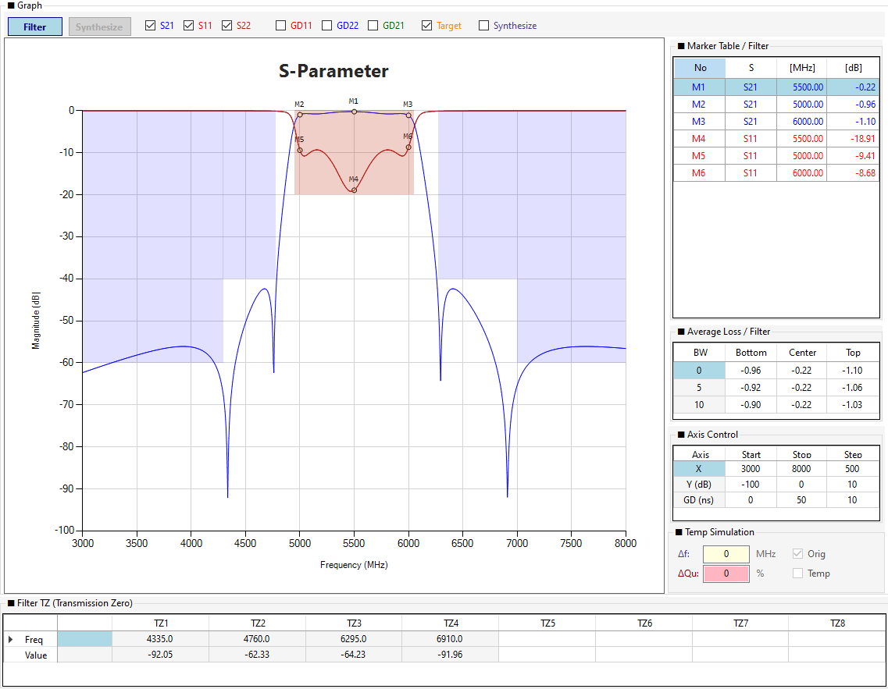
</a>

*그림 5-19: 필터 그래프에 나타난 TZ Notch*

### 5.4.6 Filter 모드에서 TZ 마커가 표시되지 않는 이유

**Filter 모드에서는 TZ가 그래프에 마커로 표시되지 않습니다.** TZ는 테이블에만 표시됩니다.

이는 다음과 같은 설계 의도에 따른 것입니다:

1. **매트릭스 연동 없음**: Filter TZ는 파형에서 자동 검출된 결과일 뿐, 매트릭스와 직접 연동되지 않습니다.
2. **마커 자유도 확보**: TZ 근처에 자유롭게 일반 마커(좌클릭 또는 Add MK)를 추가할 수 있도록 하기 위함입니다. 자세한 내용은 [Chapter 6. 마커 설정](ch06.md)을 참조하세요.
3. **Synthesize 모드와의 구분**: Synthesize 모드의 TZ(편집 가능, 그래프 마커 표시)와 Filter 모드의 TZ(표시 전용, 테이블만)를 명확히 구분합니다.

### 5.4.7 TZ 추가 후 검증

TZ를 추가한 후 다음을 확인하세요.

1. **S21 파형**: Notch가 원하는 주파수에 생성되었는지
2. **Filter TZ 테이블**: TZ 주파수와 깊이가 표시되는지
3. **Goals 마스크**: TZ가 Goals 마스크와 충돌하지 않는지
4. **다른 S-파라미터**: TZ 추가로 S11/S22가 악화되지 않았는지

!!! tip "TIP"
    TZ 추가 후 파형이 Goals를 만족하지 못하면, **5.5 Auto Tuning**으로 매트릭스를 자동 최적화하세요. Auto Tuning은 TZ를 생성하는 Cross-Coupling 값을 유지하면서 다른 파라미터(Fi, CBW, Qe)를 조정합니다.

## 5.5 Auto Tuning (Filter 모드의 매트릭스 최적화)

Goals와 TZ를 정의했다면, 이제 **Auto Tuning**으로 매트릭스 값을 자동 조정하여 Goals를 만족시키는 파형을 만듭니다.

### 5.5.1 Auto Tuning 그룹 구성

왼쪽 패널의 **Auto Tuning** 그룹은 다음 컨트롤로 구성됩니다.

<a href="../images/ch05/fig-5-20.png" target="_blank">
  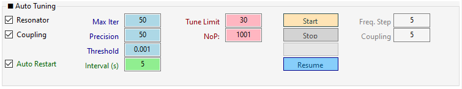
</a>

*그림 5-20: Auto Tuning 그룹 (Filter 모드)*

**최적화 대상 체크박스**

| 체크박스 | 튜닝 대상 |
|---------|----------|
| **Resonator** | 공진 주파수 (Fi) |
| **Coupling** | 커플링 계수 (CBW, Main + Cross) |
| **Tune S1&Ln** | 외부 Q (S1, Ln) |
| **Tune S2&Ln-1** | 교차 커플링 (S2, Ln-1) |
| **Tune S3&Ln-2** | 교차 커플링 (S3, Ln-2) |

!!! note "NOTE"
    Lock된 셀은 Auto Tuning 대상에서 **자동 제외**됩니다. Ignore 임계값 미만의 셀도 제외됩니다.

### 5.5.2 고급 설정 항목

Auto Tuning 그룹의 입력 필드는 **용도에 따라 두 그룹으로 나뉩니다.**

<a href="../images/ch05/fig-5-21.png" target="_blank">
  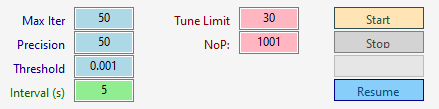
</a>

*그림 5-21: Auto Tuning 고급 설정 상세*

**① Auto Tuning에 관여하는 항목**

| 항목 | 기본값 | 설명 |
|------|--------|------|
| **Max Iter** | 50 (×1000) | 최대 반복 횟수 (입력값 × 1000) |
| **Precision** | 50 | Cost 계산 포인트 수 (클수록 정밀, 느림) |
| **Threshold** | 0.001 | 수렴 임계값 (Cost가 이 값보다 작으면 종료) |
| **Tune Limit** | 30% | 초기값 대비 최대 조정 범위 |
| **NoP** | 1001 | Number of Points (S-파라미터 계산 포인트 수) |
| **Auto Restart** | ☑ | 수렴 실패 시 자동 재시작 |
| **Interval (s)** | 5 | 재시작 간격 (초, 최대 10회) |

**② 수동 튜닝(마우스 휠) 전용 항목**

| 항목 | 기본값 | 설명 |
|------|--------|------|
| **Freq. Step** | 5 | 매트릭스 Fi 셀을 마우스 휠로 조정할 때의 증감 단위 (MHz) |
| **Coupling Step** | 5 | 매트릭스 CBW 셀을 마우스 휠로 조정할 때의 증감 단위 (MHz) |

!!! note "NOTE"
    **Freq. Step**과 **Coupling Step**은 **Auto Tuning에 관여하지 않습니다.** 이 값들은 5.2.3에서 설명한 **매트릭스 셀의 마우스 휠 조정 단위**로만 사용됩니다. Auto Tuning은 내부 Simplex 알고리즘이 자체적으로 조정 스텝을 결정합니다.

<!-- ★ 수정: Simplex 전용임을 명확히 -->
### 5.5.3 알고리즘

**현재 버전은 Nelder-Mead Simplex 알고리즘만 동작합니다.** (`cmbOptimizer` 콤보박스에 Adam/Adam+Jitter가 표시되나 실제로는 사용되지 않습니다.)

- **장점**: 도함수 불필요, 소규모 필터(N=3~4)에 강력
- **단점**: N=6 이상 고차원에서는 성능 저하
- **자동 종료**: 100회 무개선 시 조기 종료
- **Best Cost 복원**: 최적화 종료 시 가장 좋았던 매트릭스 상태로 복원
- **조정 스텝**: Simplex 알고리즘이 **내부적으로 자체 스텝 크기를 결정**합니다. Freq. Step / Coupling Step은 Auto Tuning에 사용되지 않습니다.

!!! note "NOTE"
    Synthesize 모드의 Auto Tuning은 완전히 다른 엔진(`OptimizeSynthesizeWithFixedTZAsync` → `RunTZAndRLOptimization`)을 사용하여 **RL과 TZ를 교대로 최적화**합니다. 상세는 [Chapter 4.4](ch04.md#44-synthesize-모드에서의-auto-tuning-rl-및-tz-자동-최적화)를 참조하세요.

### 5.5.4 튜닝 실행 및 진행

1. Optimization Goals가 정확히 입력되었는지 확인합니다.
2. TZ가 추가되었는지 확인합니다 (5.4).
3. Auto Tuning 그룹에서 **Start** 버튼을 클릭합니다.
4. ProgressBar가 채워지며 매트릭스가 자동 조정됩니다.

<video width="100%" controls autoplay loop muted playsinline poster="../images/ch05/fig-5-22-poster.png">
  <source src="../images/ch05/fig-5-22.mp4" type="video/mp4">
  브라우저가 동영상을 지원하지 않습니다. <a href="../images/ch05/fig-5-22.mp4">동영상 다운로드</a>
</video>

*그림 5-22: Auto Tuning 진행 과정 (동영상) — ProgressBar, 파형 실시간 갱신, 로그 업데이트*

**완료 로그 예시**:

<a href="../images/ch05/fig-5-23.png" target="_blank">
  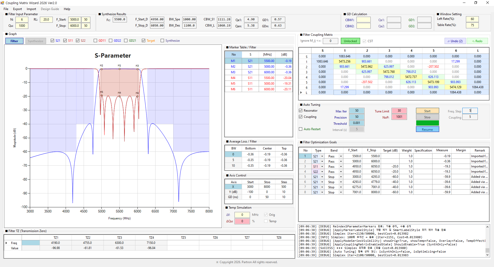
</a>

*그림 5-23: Auto Tuning 완료 로그 — ProgressBar 100%, Start 버튼 복원, "Simplex 최적화 완료" 로그 확인*

### 5.5.5 튜닝 제어 (Stop / Resume / Auto Restart)

**Stop**

- 진행 중 **Stop** 버튼을 클릭하면 즉시 중단됩니다 (`_optimizationCts.Cancel()`).
- 중단 시점의 매트릭스 상태가 유지됩니다.

**Resume**

- Stop 후 **Resume** 버튼을 클릭하면 현재 매트릭스에서 즉시 재시작합니다.
- Start와 달리 초기값으로 리셋되지 않고, 현재 상태를 이어서 최적화합니다.

<a href="../images/ch05/fig-5-24.png" target="_blank">
  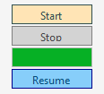
</a>

*그림 5-24: Resume 버튼 (Stop 후 재시작)*

**Auto Restart**

Auto Restart 체크박스를 켜면 수렴 실패 시 **Interval (s)** 간격으로 자동 재시작합니다.

- **최대 10회**까지만 재시작합니다 (`MAX_RESTART_CYCLES = 10`).
- 10회 후에도 Threshold에 도달하지 못하면 자동 종료됩니다.
- 목표 Cost에 도달하면 재시작 없이 조기 종료됩니다.

<a href="../images/ch05/fig-5-25.png" target="_blank">
  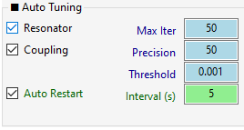
</a>

*그림 5-25: Auto Restart 설정 (체크 + Interval)*

!!! warning "WARNING"
    Auto Restart는 **최대 10회**까지만 재시작합니다. 10회 후에도 Threshold에 도달하지 못하면 자동 종료되며, 로그에 "최대 재시작 횟수 도달" 메시지가 표시됩니다.

### 5.5.6 튜닝 성공 전략

Auto Tuning이 Goals를 만족시키지 못할 때 시도할 수 있는 전략:

1. **Threshold 조정**: 0.001 → 0.005처럼 완화하여 조기 수렴 유도
2. **Precision 증가**: 50 → 100으로 정밀도 향상
3. **Resume 반복**: Stop 후 Resume으로 국소 최적점 탈출 시도
4. **Lock/Unlock 재조정**: 의심되는 셀만 Lock 해제
5. **N 재검토**: N이 부족하면 Goals 자체를 만족할 수 없음 (Synthesize 모드에서 N 재검토)
6. **수동 미세 조정**: Auto Tuning 종료 후 마우스 휠로 ±1~2MHz 미세 조정. 이때 **Freq. Step / Coupling Step** 값을 1 또는 0.5로 낮추면 정밀 조정이 가능합니다 (이 값들은 수동 튜닝 전용).

### 5.5.7 Auto Tuning 후 매트릭스 미세 조정

Auto Tuning이 완료된 후, 결과가 만족스럽지 않거나 특정 파라미터를 추가로 조정하고 싶을 때 **수동 튜닝**을 진행합니다.

**수동 튜닝 절차**:

1. Auto Tuning 그룹에서 **Freq. Step** (Fi 셀용) 또는 **Coupling Step** (CBW 셀용) 값을 원하는 증감 단위로 설정합니다 (예: 1 또는 0.5).
2. 매트릭스에서 조정할 셀을 클릭합니다.
3. 마우스 휠을 위/아래로 굴려 값을 증감합니다.
4. 파형이 실시간으로 갱신되며, 원하는 파형에 도달할 때까지 반복합니다.

!!! tip "TIP"
    Auto Tuning 직후에는 **Coupling Step**을 0.5~1로 낮추어 정밀 조정하는 것이 효과적입니다. Freq. Step도 1~2로 낮추면 Fi를 세밀하게 조정할 수 있습니다.

!!! note "NOTE"
    수동 튜닝 중에도 **Lock된 셀은 편집되지 않습니다.** 특정 셀을 고정하고 나머지만 조정하려면 Lock 기능을 활용하세요 (5.2.4 참조).

## 5.6 S-파라미터 실시간 확인

Auto Tuning 또는 매트릭스 편집 후, 실제 파형을 확인하고 세부 조정합니다.

### 5.6.1 파형 표시 제어

그래프 상단의 체크박스로 표시할 파형을 선택합니다.

| 체크박스 | 표시 파형 | 색상 |
|---------|----------|------|
| **S11** | Tune S11 (반사 손실) | 빨강 |
| **S21** | Tune S21 (투과 특성) | 파랑 |
| **S22** | Tune S22 (출력 반사) | 갈색 |
| **GD11** | GD Tune S11 (군지연) | 빨강 (우측 축) |
| **GD21** | GD Tune S21 | 진초록 (우측 축) |
| **GD22** | GD Tune S22 | 파랑 (우측 축) |
| **Target** | Optimization Goals 마스크 (해칭) | - |
<!-- ★ 수정: Compare 체크박스 추가 -->
| **Compare** | 외부 s2p 오버레이 (Import s2p 후) | 점선 (Compare S11/S21/S22) |

<a href="../images/ch05/fig-5-26.png" target="_blank">
  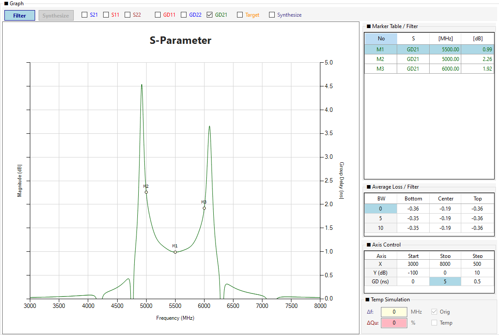
</a>

*그림 5-26: GD 체크박스 ON 상태 (우측 축에 GD 표시)*

!!! tip "TIP"
    GD(Group Delay)를 표시하면 우측에 보조 Y축이 나타납니다. GD 축의 범위는 Axis Control의 **GD (ns)** 행에서 조정할 수 있습니다.

### 5.6.2 Overlay Synth (Filter 모드 전용)

Filter 모드에서 **Overlay Synth** 체크박스를 켜면 **Synth 파형이 오버레이**로 표시됩니다.

- 파형 비교 목적으로 사용됩니다 (Filter 파형 vs Synthesize 파형).
- Synth 마커는 표시되지 않습니다.
- Filter 파라미터(N, BW, RL, Qu)를 공유하므로, Filter 파라미터를 변경하면 Synth 파형도 함께 갱신됩니다.

<a href="../images/ch05/fig-5-27.png" target="_blank">
  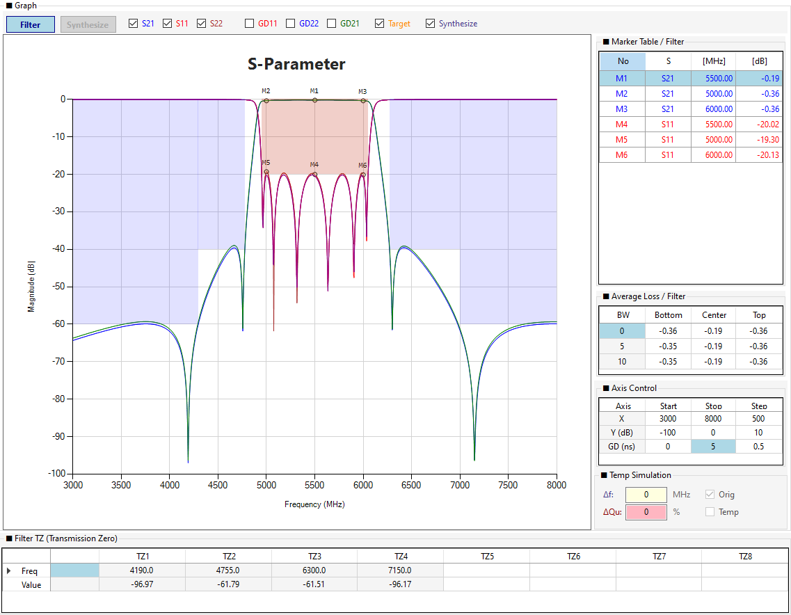
</a>

*그림 5-27: Overlay Synth 체크 시 Synth 파형 오버레이*

### 5.6.3 Compare (외부 s2p 오버레이)

**Import → Import s2p**로 외부 s2p 파일을 로드하면 **Compare** 체크박스가 표시됩니다.

- 체크 시 Compare S11/S21/S22 파형이 점선으로 표시됩니다.
- Compare 마커(CM1, CM2, ...)는 기존 마커와 완전히 분리되어 관리됩니다.
- 상세 사용법은 [Chapter 8. s2p Import](ch08.md)를 참조하세요.

## 5.7 Average Loss (평균 손실)

Average Loss 테이블은 **통과대역 내 구간별 평균 삽입 손실**을 보여줍니다.

### 5.7.1 테이블 구조

| 열 | 설명 |
|----|------|
| **BW** | 계산할 대역폭 (MHz). 0/5/10 기본값. 편집 가능 (0행 제외) |
| **Bottom** | F_Start ~ F_Start+BW 구간 평균 (dB) |
| **Center** | Fc±BW/2 구간 평균 (dB) |
| **Top** | F_Stop-BW ~ F_Stop 구간 평균 (dB) |

<a href="../images/ch05/fig-5-28.png" target="_blank">
  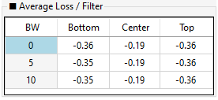
</a>

*그림 5-28: Average Loss 테이블*

### 5.7.2 BW 값 편집

- **0행** (`BW=0`): 편집 불가 (F_Start, Fc, F_Stop 지점의 단일 주파수 값)
- **1행** (`BW=5`): 기본값 5. 편집 가능
- **2행** (`BW=10`): 기본값 10. 편집 가능

BW 값을 변경하면 해당 구간의 평균 손실이 즉시 재계산됩니다.

!!! note "NOTE"
    Average Loss는 **현재 화면에 표시 중인 S21 시리즈**를 기준으로 계산됩니다. Temp Simulation이 ON이고 Temp 파형이 표시 중이면 **Temp S21** 기준으로 계산됩니다. 자세한 내용은 [Chapter 7. Temp Simulation](ch07.md)을 참조하세요.

## 5.8 Axis Control (축 범위 제어)

Axis Control 테이블은 그래프의 X축/Y축/GD축 범위를 수동으로 조정합니다.

### 5.8.1 테이블 구조

| 행 | Start | Stop | Step |
|----|-------|------|------|
| **X** | 4740 | 6250 | 150 |
| **Y (dB)** | -100 | 0 | 10 |
| **GD (ns)** | 0 | 50 | 5 |

<a href="../images/ch05/fig-5-29.png" target="_blank">
  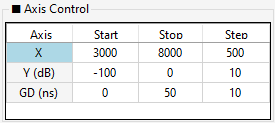
</a>

*그림 5-29: Axis Control 편집*

### 5.8.2 편집 방법

- 셀 클릭 → 값 입력 → `Enter`
- 마우스 휠로 증감 (Step 단위)
- Start/Stop 변경 시 **Step 자동 재계산** ((Stop-Start)/10)

### 5.8.3 축 리셋

- 그래프에서 **우클릭** → Axis Control 값으로 복귀
- `ESC` 또는 `Space` 키 → Axis Control 값으로 복귀
- 줌 상태에서 벗어나 항상 Axis Control 값이 기준이 됩니다

## 5.9 Filter 모드 워크플로우 요약

1. **Synthesize 모드에서 이상 파형 확정** (Ch 4)
2. **Filter 모드 진입** (Filter 버튼)
3. **매트릭스 초기값 확인** (5.2)
4. **Optimization Goals 정의** (5.3)
5. **TZ 추가** (5.4)
6. **Auto Tuning 실행** (5.5)
7. **S-파라미터 실시간 검증** (5.6)
8. **Average Loss 분석** (5.7)
9. **Axis Control** (5.8)

!!! tip "TIP"
    Filter 모드에서 최종 확정된 매트릭스는 **File → Save File**로 CSV 프로젝트로 저장할 수 있습니다. 파일 저장/불러오기 상세는 [Chapter 8. 파일 입출력](ch08.md)을 참조하세요.