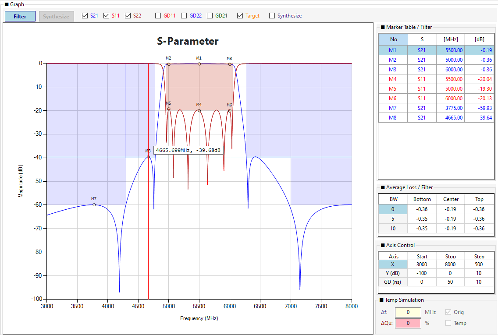
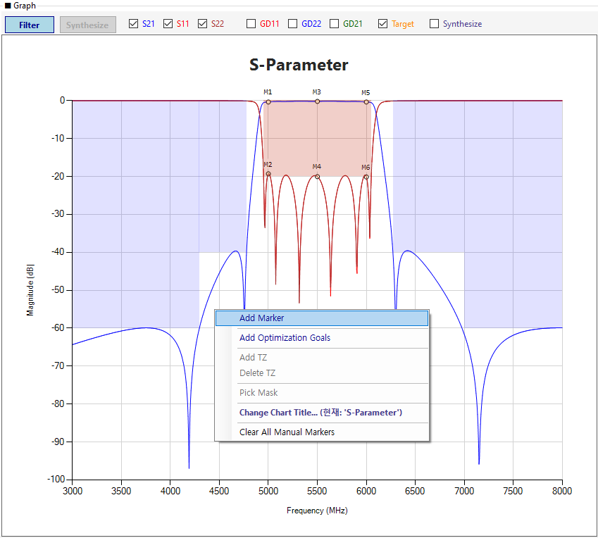
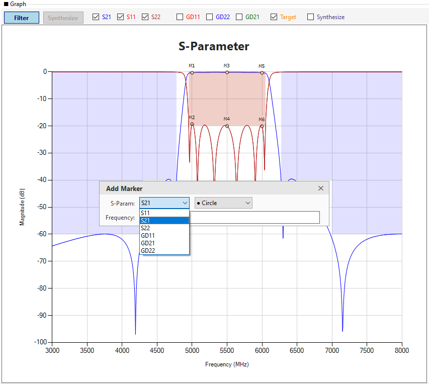
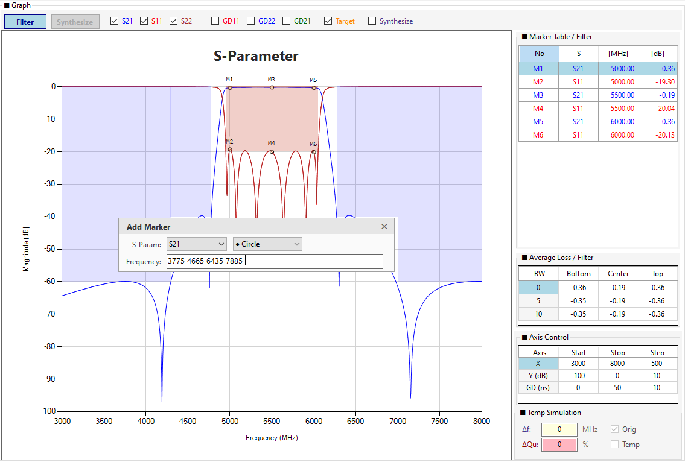
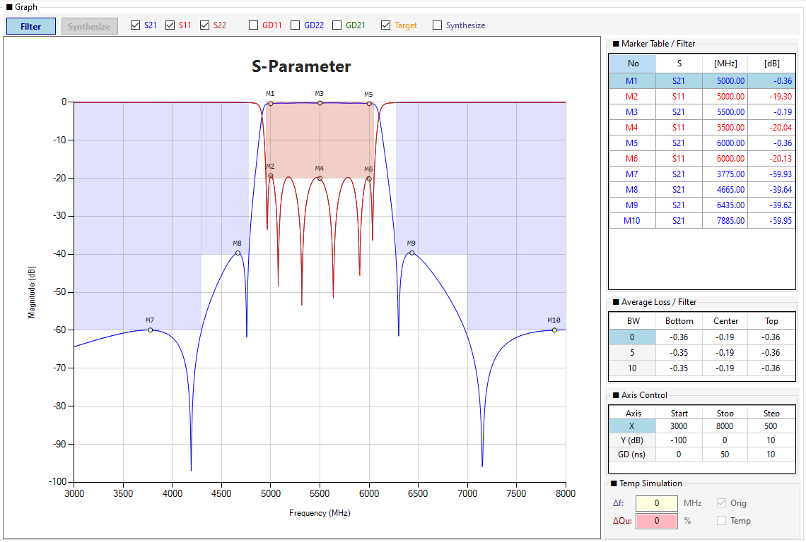
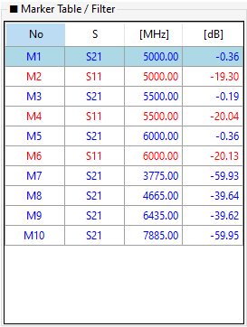
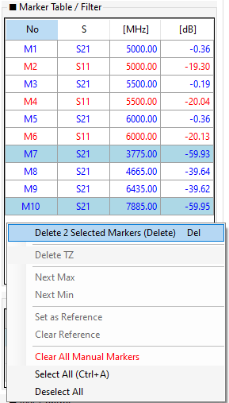
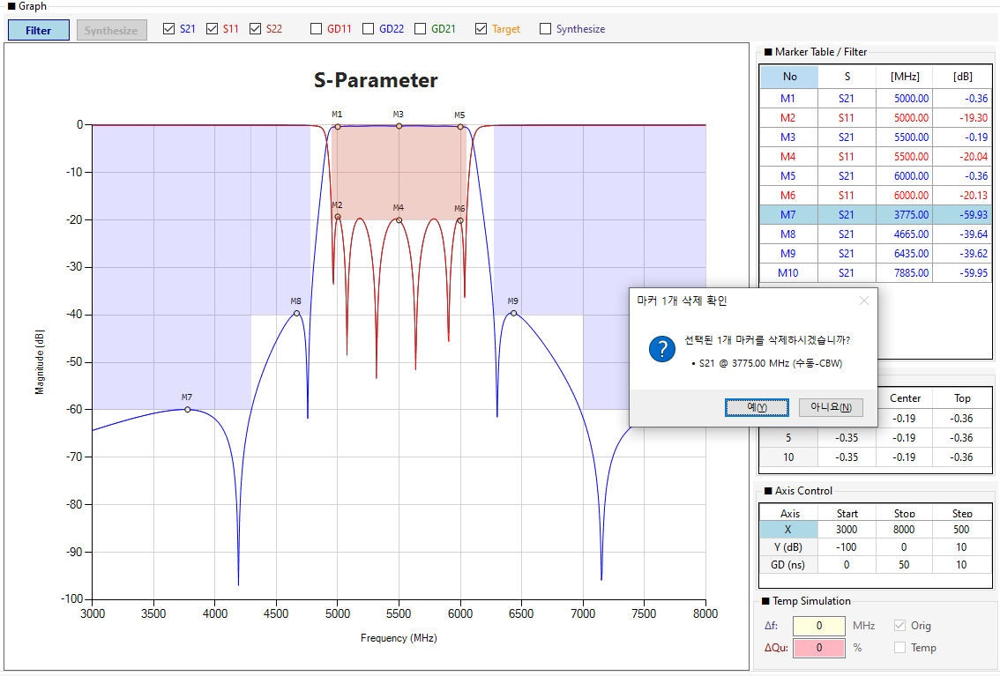
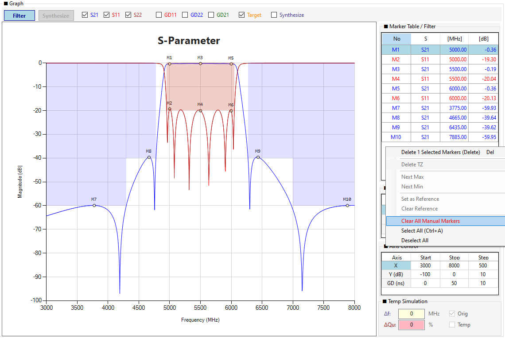

# Chapter 6. 마커 설정

마커(Marker)는 그래프 상의 특정 주파수 지점에서 **정확한 S-파라미터 값(dB) 또는 Group Delay 값(ns)** 을 읽기 위한 도구입니다. 이 장에서는 마커의 추가/편집/삭제 방법과 라벨 표시 규칙, Marker Table 활용법을 단계적으로 설명합니다.

!!! note "NOTE"
    마커 기능은 **Filter(CBW) 모드**와 **Synthesize 모드** 모두에서 사용할 수 있습니다. 두 모드의 마커는 독립적으로 관리되며, 각 모드로 전환하면 해당 모드의 마커만 표시됩니다.

## 6.1 마커의 역할과 종류

### 6.1.1 마커가 필요한 이유

S-파라미터 그래프는 수백~수천 개의 데이터 포인트로 구성됩니다. 특정 지점의 정확한 값을 읽으려면 다음 방법이 필요합니다.

- **정확한 값 읽기**: 마우스 커서로는 정확한 dB 값을 읽기 어려움 → 마커로 정밀 측정
- **비교 분석**: 여러 지점의 값을 동시에 비교 (예: 통과대역 리플의 최대/최소)
- **TZ 깊이 확인**: Notch의 정확한 깊이(dB) 확인
- **Goals 검증**: Optimization Goals의 Target 대비 실제 Measure 값 확인

### 6.1.2 마커의 두 가지 종류

프로그램은 마커를 **자동 마커**와 **수동 마커**로 구분하여 관리합니다.

| 종류 | 생성 방법 | 색상 | 번호 | 삭제 방식 |
|------|----------|------|------|----------|
| **자동 마커** | Optimization Goals 기반 자동 생성 | **흰색** 원 | M1, M2, ... | Goals 변경 시 자동 갱신 |
| **수동 마커** | 사용자 클릭 또는 Add MK | **연노랑** 원 | M1, M2, ... (자동 마커 이후) | 개별 삭제 가능 |

!!! note "NOTE"
    현재 버전에서는 **자동 마커 생성이 비활성화**되어 있습니다 (`_disableAutoMarkers = True`). 따라서 대부분의 마커는 사용자가 직접 추가하는 **수동 마커**입니다. 자동 마커 기능은 향후 버전에서 다시 활성화될 수 있습니다.

### 6.1.3 마커가 표시될 수 있는 시리즈

마커는 다음 시리즈에 추가할 수 있습니다.

| 시리즈 | 모드 | 측정값 단위 |
|--------|------|------------|
| Tune S11 / S21 / S22 | Filter(CBW) | dB |
| Synth S11 / S21 / S22 | Synthesize | dB |
| GD Tune S11 / S21 / S22 | Filter(CBW) | ns |
| GD Synth S11 / S21 / S22 | Synthesize | ns |
| Temp S11 / S21 / S22 | Temp Simulation ON | dB |
| GD Temp S11 / S21 / S22 | Temp Simulation ON | ns |
| Compare S11 / S21 / S22 | Import s2p 후 | dB |

## 6.2 마커 추가

마커를 추가하는 방법은 **2가지**입니다.

| 방법 | 특징 | 사용 시나리오 |
|------|------|-------------|
| **① 그래프 클릭** | 가장 빠르고 직관적. 클릭 지점 근처 데이터 포인트에 자동 스냅 | 파형을 보며 마커 추가 |
| **② 우클릭 → Add MK** | 정확한 주파수 입력, 다중/범위 입력, 시리즈/스타일 선택 | 특정 주파수에 정확히 마커 추가 |

### 6.2.1 방법 ①: 그래프 클릭으로 마커 추가

**그래프 상의 원하는 지점을 마우스로 클릭하면 마커가 추가됩니다.** 가장 빠르고 직관적인 방법입니다.

**실습 절차**:

1. 그래프 상의 원하는 지점을 **마우스 좌클릭**합니다.
2. 클릭 지점에서 **가장 가까운 데이터 포인트**(허용 오차 20px)를 자동으로 찾습니다.
3. 해당 포인트에 마커가 추가되고, 라벨(M번호)이 자동 부여됩니다.
4. 마커는 **연노랑 원**으로 표시되며, Marker Table에 즉시 등록됩니다.

*그림 6-1: 그래프 클릭으로 마커 추가*

**모드별 동작**:

| 모드 | 클릭 시 마커가 추가되는 시리즈 |
|------|---------------------------|
| **Filter(CBW) 모드** | Tune S21 (S21 체크박스 ON 필요) + GD 체크 시: GD11/GD21/GD22 중 클릭 지점 근처 |
| **Synthesize 모드** | Synth S11/S21/S22 중 클릭 지점에서 가장 가까운 시리즈 |

!!! tip "TIP"
    **S11 또는 S22에 정확히 마커를 추가**하고 싶다면 **Add MK** 방법(6.2.2)을 사용하세요. 그래프 클릭은 가장 가까운 시리즈에 자동으로 마커를 추가하므로, 특정 시리즈를 지정하기 어려울 수 있습니다.

!!! warning "WARNING"
    **다음 상황에서는 그래프 클릭으로 마커가 추가되지 않습니다.**

    - **TZ 드래그 중**: 드래그가 우선 처리됩니다.
    - **줌 드래그 중**: 영역 선택이 우선 처리됩니다.
    - **Pick Mask 모드**: 마스크 지정이 우선 처리됩니다.
    - **우클릭**: 좌클릭만 마커를 추가합니다.
    - **클릭 지점 근처에 데이터 포인트가 없음**: 허용 오차(20px)를 벗어나면 무시됩니다.
    - **해당 시리즈가 비어있음**: S21 체크박스가 꺼져 있거나 데이터가 없으면 추가되지 않습니다.

**연속 클릭으로 여러 마커 추가**:

그래프를 클릭 → 마커 추가 → 다시 클릭 → 또 추가... 를 반복하면 **여러 개의 마커를 빠르게 추가**할 수 있습니다. 마커 번호는 자동으로 M1, M2, M3, ... 로 증가합니다.

*그림 6-1a: 그래프 연속 클릭으로 여러 마커 추가*

### 6.2.2 방법 ②: 우클릭 → Add MK

정확한 주파수에 마커를 추가하거나, 특정 시리즈(S11/S22/GD)에 마커를 추가할 때 사용합니다.

**실습 절차**:

1. 그래프 빈 공간에서 **우클릭**합니다.
2. **Add MK (S11/S21/S22)** 메뉴를 클릭합니다.

*그림 6-2: 그래프 우클릭 → Add MK 메뉴*

3. **Add MK 팝업**이 열립니다. 다음을 선택합니다:
   - **S-Param**: S11, S21, S22, GD11, GD21, GD22, Compare S11/S21/S22 중 선택
   - **Marker Style**: ● Circle, ▲ Triangle, ◆ Diamond, ★ Star, ■ Square, ✚ Cross 중 선택

*그림 6-3: Add MK 팝업 (S-Param + Marker Style)*

4. 주파수를 입력하고 `Enter`를 누릅니다 (예: `5000`).

!!! tip "TIP"
    Add MK 팝업은 **모달리스(Modaless)** 로 동작합니다. `Enter`로 마커를 추가한 뒤에도 창이 닫히지 않아 **연속 입력**이 가능합니다. 팝업 우측 상단의 `✕` 버튼 또는 `ESC` 키로 닫을 수 있습니다.

### 6.2.3 다중 주파수 및 범위 입력

Add MK 팝업의 주파수 입력란에 **여러 주파수를 한 번에 입력**할 수 있습니다.

**다중 주파수 입력 (콤마 구분)**

`4950, 5000, 5050` → 3개의 마커가 동시에 추가됩니다.

**범위 입력 (하이픈 구분)**

`4950-5050` → 4950부터 5050까지 **0.5MHz 간격**으로 자동 추가됩니다 (약 201개).

**혼합 입력**

`4950, 5000-5050, 6000` → 4950 (1개) + 5000~5050 (101개) + 6000 (1개) = 총 103개

*그림 6-4: 다중 주파수 및 범위 입력 예시*

!!! warning "WARNING"
    **범위 입력은 신중히 사용하세요.** `4900-5100`처럼 넓은 범위를 입력하면 수백 개의 마커가 생성되어 그래프가 매우 복잡해지고 성능이 저하될 수 있습니다. 필요한 경우 **좁은 범위**로 입력하세요.

### 6.2.4 마커 스타일 선택

Add MK 팝업의 **Marker Style** 콤보박스에서 마커 기호를 선택할 수 있습니다.

| 스타일 | 기호 | 용도 |
|--------|------|------|
| Circle | ● | 기본값 |
| Triangle | ▲ | TZ 마커와 유사 (주의) |
| Diamond | ◆ | 특별한 지점 강조 |
| Star | ★ | 중요 마커 강조 |
| Square | ■ | - |
| Cross | ✚ | - |

!!! tip "TIP"
    **Triangle(▲)** 은 TZ(Transmission Zero) 마커와 혼동될 수 있습니다. TZ 마커는 Synthesize 모드에서 자동 생성되는 삼각형이므로, 일반 마커에는 **Circle(●)** 또는 **Diamond(◆)** 를 권장합니다.

### 6.2.5 그래프 클릭 vs Add MK 비교

두 방법의 차이를 정리하면 다음과 같습니다.

| 항목 | 그래프 클릭 | Add MK |
|------|-----------|--------|
| **속도** | 매우 빠름 (1클릭) | 팝업 입력 필요 |
| **정확도** | 근처 데이터 포인트에 스냅 (20px) | 정확한 주파수 입력 가능 |
| **시리즈 선택** | 자동 (가장 가까운 시리즈) | 수동 (S11/S21/S22/GD11/GD21/GD22/Compare) |
| **다중 입력** | 불가 (1개씩) | 콤마/범위로 다중 입력 가능 |
| **스타일 선택** | Circle 고정 | 6가지 선택 가능 |
| **연속 입력** | 클릭 반복 | 팝업 유지 (모달리스) |

!!! tip "TIP"
    **파형을 보며 빠르게 마커를 찍고 싶을 때**는 그래프 클릭을, **정확한 주파수에 특정 시리즈로 마커를 추가하고 싶을 때**는 Add MK를 사용하세요.

## 6.3 마커 라벨 표시 규칙

프로그램은 그래프의 가독성을 극대화하기 위해 **마커 라벨 위치를 자동으로 결정**합니다.

### 6.3.1 시리즈별 라벨 위치

| 시리즈 | 라벨 위치 | 이유 |
|--------|----------|------|
| **S21 계열** (Tune S21, Synth S21, Temp S21, GD21) | 마커 **위** | S21 파형은 보통 -60~0dB 영역이라 위쪽 여유 공간이 많음 |
| **S11/S22 계열** (Tune S11, S22, Synth S11, S22, Temp S11, S22, GD11, GD22) | 마커 **아래** | S11/S22는 보통 -20dB 이하로 낮아, 아래쪽 여유 공간이 많음 |

*그림 6-5: 다중 마커가 추가된 그래프 (S21=위, S11=아래)*

### 6.3.2 SmartLabelStyle 자동 회피

라벨이 서로 겹치지 않도록 **SmartLabelStyle**이 자동으로 위치를 조정합니다.

- **AllowOutsidePlotArea**: 그래프 영역 밖으로도 라벨 표시 가능
- **IsMarkerOverlappingAllowed**: 겹침 허용 (자동 회피 시도)
- **CalloutStyle**: None (라벨과 마커 사이 연결선 없음)
- **MovingDirection**: S21=Top, S11/S22=Bottom

### 6.3.3 마커 크기와 테두리

- **MarkerSize**: 6 (기본값 4에서 50% 확대)
- **MarkerBorderColor**: Black
- **MarkerBorderWidth**: 1 (얇게)
- **MarkerColor**: 수동=LightYellow, 자동=White

## 6.4 Marker Table (마커 리스트)

### 6.4.1 테이블 구조

그래프 아래의 **Marker Table**은 모든 마커를 리스트로 보여줍니다.

| 열 | 설명 | 편집 가능 |
|----|------|----------|
| **No** | 마커 번호 (M1, M2, ...) | ❌ |
| **S** | S-파라미터 타입 (S11, S21, S22, GD11, GD21, GD22, C-S11, C-S21, C-S22) | ❌ |
| **[MHz]** | 주파수 | ✅ (편집 가능) |
| **[dB]** | 측정값 (S-파라미터=dB, GD=ns) | ✅ (편집 가능) |

*그림 6-6: Marker Table (자동 + 수동 마커)*

### 6.4.2 주파수 편집 (마커 이동)

Marker Table의 **[MHz]** 셀을 직접 편집하여 마커를 **정확한 주파수로 이동**할 수 있습니다.

**실습 절차**:

1. 마커 행의 [MHz] 셀을 클릭합니다.
2. 새 주파수를 입력하고 `Enter`를 누릅니다.
3. 마커가 새 주파수로 이동하며, 그래프와 라벨도 갱신됩니다.

!!! note "NOTE"
    주파수 편집 시 가장 가까운 데이터 포인트로 **자동 스냅**됩니다. 데이터 포인트 간격(예: 0.5MHz)보다 세밀한 위치로는 이동할 수 없습니다.

### 6.4.3 값 편집

[dB] 셀을 직접 편집할 수도 있습니다. 이는 **마커 값을 수동으로 기록**할 때 유용합니다.

### 6.4.4 다중 선택 및 일괄 삭제

Marker Table은 **다중 선택**을 지원합니다.

**방법 1: Ctrl 키**
1. 첫 번째 마커를 클릭합니다.
2. `Ctrl` 키를 누른 채로 추가 마커를 클릭합니다.

**방법 2: Shift 키**
1. 첫 번째 마커를 클릭합니다.
2. `Shift` 키를 누른 채로 마지막 마커를 클릭합니다.
3. 두 마커 사이의 모든 마커가 선택됩니다.

**삭제**:
1. 선택된 마커에서 `Delete` 키를 누릅니다.
2. 확인 대화상자가 표시되면 **예**를 클릭합니다.

*그림 6-7: 마커 다중 선택 후 Delete*

!!! tip "TIP"
    `Ctrl+A`를 누르면 모든 마커가 선택됩니다. 이 상태에서 `Delete`를 누르면 전체 마커가 한 번에 삭제됩니다.

## 6.5 마커 삭제 및 초기화

### 6.5.1 개별 마커 삭제

**방법 1: Delete 키**
1. Marker Table에서 삭제할 마커를 선택합니다.
2. `Delete` 키를 누릅니다.
3. 확인 대화상자에서 **예**를 클릭합니다.

**방법 2: 마커 테이블 우클릭 메뉴**
1. 삭제할 마커를 우클릭합니다.
2. **Delete Selected Markers (Delete)** 메뉴를 클릭합니다.

*그림 6-8: 마커 테이블 우클릭 컨텍스트 메뉴*

### 6.5.2 수동 마커 전체 삭제

그래프 우클릭 → **Clear All Manual Markers** 메뉴로 **모든 수동 마커를 한 번에 삭제**할 수 있습니다.

1. 그래프 빈 공간을 우클릭합니다.
2. **Clear All Manual Markers** 메뉴를 클릭합니다.
3. 확인 대화상자에서 **예**를 클릭합니다.

*그림 6-9: Clear All Manual Markers 결과 (모든 수동 마커 제거)*

!!! warning "WARNING"
    **Clear All Manual Markers**는 수동 마커만 삭제합니다. **자동 마커와 TZ 마커는 유지**됩니다. 만약 자동 마커도 초기화하려면 확인 대화상자에서 추가 옵션을 선택하세요.

<!-- ★ 수정: 자동 마커 삭제 플래그 설명 명확화 -->
### 6.5.3 자동 마커 삭제 플래그

자동 마커가 활성화된 경우, 특정 자동 마커를 삭제하면 **삭제 플래그**가 설정되어 **다시 생성되지 않습니다**.

- `deletedCBWAutoMarkers`: Filter 모드에서 삭제된 자동 마커 목록 (`"Type_Freq"` 형식, 예: `"S21_1950.0"`)
- `deletedSynthAutoMarkers`: Synthesize 모드에서 삭제된 자동 마커 목록

이 플래그는 **Clear All** 시 초기화됩니다. 또한 그래프 우클릭 → **Clear All Manual Markers** 대화상자에서 자동 마커 플래그 초기화 여부를 선택할 수 있습니다.

## 6.6 마커 편집 시 주의사항

### 6.6.1 편집 중 vs 편집 외

Marker Table의 [MHz] 셀은 **편집 중**과 **편집 외** 상태에서 동작이 다릅니다.

| 상태 | 동작 |
|------|------|
| **편집 외** (셀 클릭 후 Enter 전) | 셀 선택만 됨 (값 변경 없음) |
| **편집 중** (더블클릭 또는 F2) | 키보드 입력, Enter로 확정 |

!!! note "NOTE"
    Marker Table의 주파수 셀은 **마우스 휠로 값이 변경되지 않습니다.** 값 변경은 **직접 입력 후 Enter**로만 가능합니다.

### 6.6.2 편집 확정

- **Enter**: 값 확정
- **ESC**: 편집 취소 (원래 값 복복원)
- **다른 셀 클릭**: 자동 확정

### 6.6.3 마커 재색인

마커 삭제/추가 시 **자동으로 번호가 재정렬**됩니다 (M1, M2, M3, ...). 예를 들어 M2를 삭제하면 M3가 M2로, M4가 M3로 재번호됩니다.

!!! note "NOTE"
    Compare 마커(CM1, CM2, ...)는 기존 마커(M1, M2, ...)와 **별도의 번호 체계**를 사용하며, 재색인 시에도 서로 영향을 주지 않습니다.