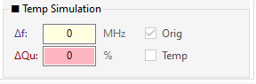
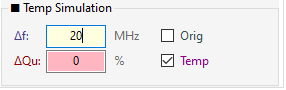
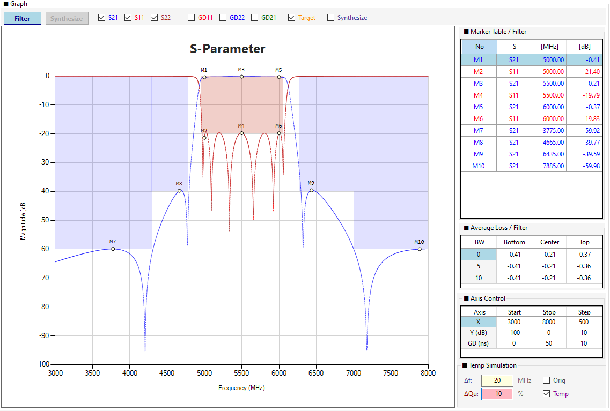
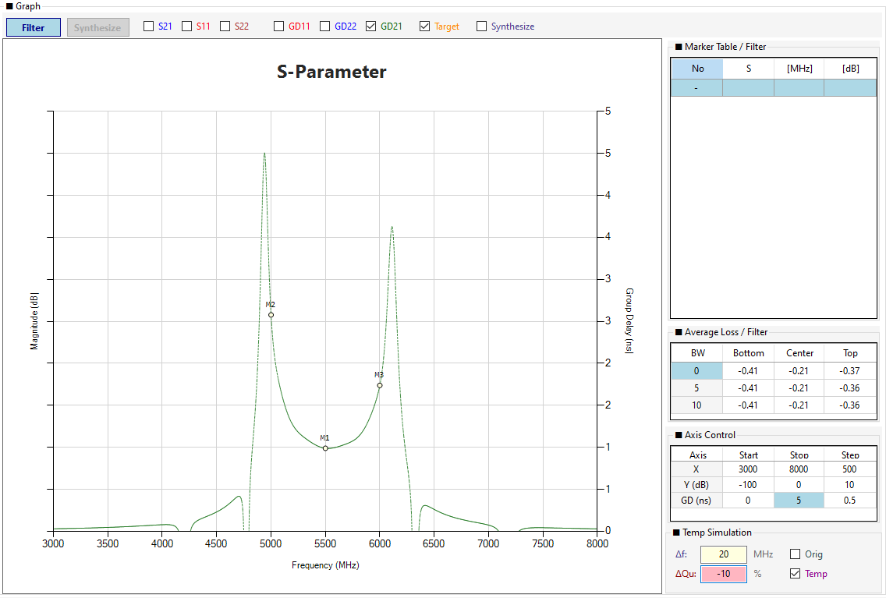
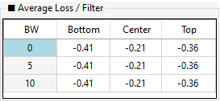
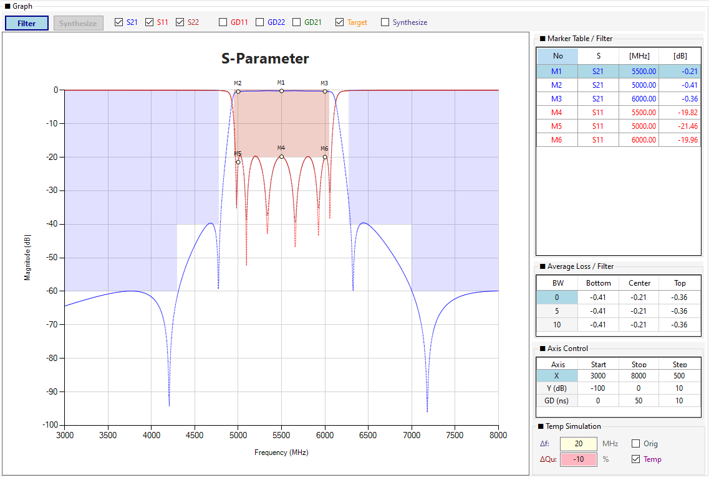
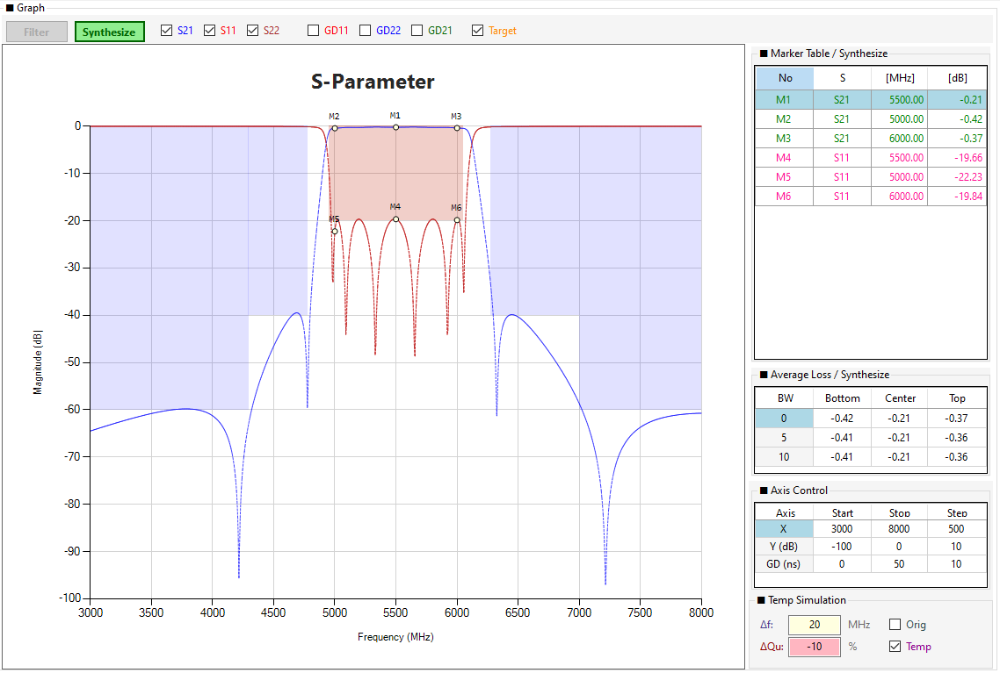

# Chapter 7. Temp Simulation (온도 시뮬레이션)

Temp Simulation은 **온도 변화에 따른 필터 성능 변화를 시뮬레이션**하는 기능입니다. 실제 마이크로파 필터는 온도가 변하면 재료의 열팽창과 도전율 변화로 인해 **중심 주파수가 이동**하고 **Q 값이 저하**됩니다. Temp Simulation을 사용하면 이러한 변화를 미리 예측하여, 설계된 필터가 극한 온도 환경에서도 규격을 만족하는지 검증할 수 있습니다.

!!! note "NOTE"
    Temp Simulation은 **Filter(CBW) 모드**와 **Synthesize 모드** 모두에서 사용할 수 있으며, 각 모드의 온도 조건은 **독립적으로 관리**됩니다.

## 7.1 Temp Simulation의 목적

### 7.1.1 왜 온도 시뮬레이션이 필요한가?

실제 필터는 다음과 같은 온도 의존성을 가집니다.

| 물리 현상 | 영향 | 결과 |
|----------|------|------|
| **열팽창** | 공진기 치수 변화 | 중심 주파수 이동 (Δf) |
| **도전율 변화** | 도체 표면 저항 증가 | Q 값 저하 (ΔQu), 삽입 손실 증가 |
| **유전체 상수 변화** | 유전체 공진기 주파수 이동 | 중심 주파수 이동 (Δf) |

이러한 변화는 **상온(25°C)에서 설계된 필터가 극한 온도(예: -40°C ~ +85°C)에서 규격을 벗어날 수 있음**을 의미합니다.

### 7.1.2 Temp Simulation으로 예측 가능한 것

Temp Simulation을 사용하면 다음 항목들을 **정량적으로 예측**할 수 있습니다.

| 예측 항목 | 확인 방법 | 활용 |
|----------|----------|------|
| **중심 주파수 이동** | Temp 파형의 S21 중심 위치 | 통과대역이 규격 범위를 벗어나는지 확인 |
| **삽입 손실 증가** | Temp 파형의 S21 레벨 | Average Loss 테이블에서 정량 확인 |
| **반사 손실 변화** | Temp 파형의 S11 레벨 | RL 규격 만족 여부 확인 |
| **TZ 위치 이동** | Temp 파형의 Notch 위치 | 저지대역 감쇠 규격 확인 |
| **Group Delay 변화** | GD Temp 파형 | 위상 왜곡, 신호 지연 변화 확인 |
| **온도 마진** | Orig vs Temp 비교 | 극한 온도에서의 안전 마진 |

### 7.1.3 실무 활용 시나리오

Temp Simulation은 다음과 같은 실무 상황에서 유용합니다.

**시나리오 1: 온도 마진 확인**
> "이 필터가 -40°C ~ +85°C에서 통과대역을 유지할 수 있는가?"
> → Δf=±5MHz, ΔQu=-10%로 시뮬레이션하여 규격 만족 여부 확인

**시나리오 2: 재료 선택**
> "Qu=1000 재료와 Qu=2000 재료 중 어느 것이 온도 변화에 더 강인한가?"
> → 동일 ΔQu 조건에서 삽입 손실 증가량 비교

**시나리오 3: TZ 배치 검증**
> "온도 변화 시 TZ가 저지대역 규격을 벗어나지 않는가?"
> → Temp 파형에서 TZ 위치 이동 확인

**시나리오 4: 설계 튜닝 방향 결정**
> "중심 주파수를 상온에서 얼마나 이동시켜야 극한 온도에서도 규격을 만족하는가?"
> → 온도 마진을 고려한 목표 Fc 조정

## 7.2 Temp Simulation의 물리적 원리

### 7.2.1 주파수 이동 (Δf)

온도 변화에 의해 공진기의 공진 주파수(Fi)가 이동하는 현상입니다.

**수식**:

Fi_new = Fi_orig + Δf

- **Fi_orig**: 원래 공진 주파수 (MHz)
- **Δf**: 온도에 의한 주파수 이동량 (MHz)
  - **양수 (+)**: 주파수 상향 이동 (일반적으로 고온)
  - **음수 (-)**: 주파수 하향 이동 (일반적으로 저온)

**프로그램 동작**:
- 모든 공진기(i=1~N)의 Fi에 **동일한 Δf를 더함**
- 파형 전체가 Δf만큼 **평행 이동**

!!! note "NOTE"
    실제 온도 계수(TCF)는 재료에 따라 다르지만, Temp Simulation은 **사용자가 입력한 Δf를 일괄 적용**하는 단순 모델을 사용합니다. 정밀한 온도 계수 모델링은 향후 버전에서 지원될 수 있습니다.

### 7.2.2 Qu 저하 (ΔQu)

온도 상승 시 도체의 표면 저항이 증가하여 무부하 Q(Qu)가 감소하고, 이는 삽입 손실(Insertion Loss)의 증가로 이어집니다.

**수식**:

Qu_new = Qu_orig × (1 + ΔQu / 100)

- **Qu_orig**: 원래 무부하 Q (예: 1000)
- **ΔQu**: Q 저하율 (%)
  - **-10**: Qu가 90%로 감소 (1000 → 900)
  - **-20**: Qu가 80%로 감소 (1000 → 800)
  - **+10**: Qu가 110%로 증가 (1000 → 1100)

**프로그램 동작**:
- 손실 계수 `loss = 1 / (Qu_new × FBW)`를 재계산
- S-파라미터 계산 시 이 손실 계수를 반영
- 결과적으로 **삽입 손실 증가** (통과대역 S21 레벨 저하)

!!! tip "TIP"
    **ΔQu는 -10% 이하를 권장**합니다. 일반적으로 온도 상승에 따른 Qu 저하는 -10~-20% 수준입니다. ΔQu를 -50%처럼 과도하게 설정하면 비현실적인 손실이 발생할 수 있습니다.

### 7.2.3 Temp Simulation의 한계

Temp Simulation은 **단순 선형 모델**로, 다음 한계를 가집니다.

- **균일 온도 가정**: 모든 공진기가 동일한 온도 변화를 겪는다고 가정 (실제로는 온도 분포가 불균일할 수 있음)
- **선형 모델**: Δf와 ΔQu를 선형으로 적용 (비선형 효과는 무시)
- **재료 모델 부재**: 재료별 TCF, 온도 계수는 자동 적용되지 않음 (사용자가 직접 입력)

정밀한 온도 해석이 필요하면 **CST/HFSS의 열-전자기 연성 해석**을 사용해야 합니다. Temp Simulation은 **빠른 1차 검증**에 적합합니다.

## 7.3 Temp Simulation 사용 방법

### 7.3.1 Temp Simulation 그룹박스

Temp Simulation 그룹박스는 화면 우측 하단의 **Axis Control 아래**에 위치합니다.

*그림 7-1: Temp Simulation 그룹박스 (Δf, ΔQu, Orig/Temp)*

**구성 요소**:

| 요소 | 설명 |
|------|------|
| **Δf:** | 주파수 이동량 입력란 (MHz) |
| **ΔQu:** | Q 저하율 입력란 (%) |
| **Orig** | 원본 파형 표시 체크박스 |
| **Temp** | Temp 파형 표시 체크박스 |

### 7.3.2 입력 방법

**실습 절차**:

1. **Δf** 입력란을 클릭합니다.
2. 값을 입력합니다 (예: `+5.0` 또는 `-5.0`).
3. **Enter** 키를 누릅니다.
4. **ΔQu** 입력란을 클릭합니다.
5. 값을 입력합니다 (예: `-10`).
6. **Enter** 키를 누릅니다.

!!! warning "WARNING"
    Temp Simulation 값은 **Enter 키로 확정**해야 반영됩니다. 마우스로 다른 곳을 클릭하면 값이 반영되지 않습니다.

### 7.3.3 자동 전환 규칙

프로그램은 사용자 편의를 위해 **자동 전환 규칙**을 제공합니다.

| 입력 상태 | Orig | Temp | 동작 |
|----------|------|------|------|
| **Δf=0 AND ΔQu=0** (초기) | ☑ (강제) | ☐ (강제) | 두 체크박스 비활성화 |
| **Δf≠0 OR ΔQu≠0 입력** | ☐ (자동 해제) | ☑ (자동 체크) | Temp 파형 자동 표시 |
| **Orig 수동 체크** | ☑ | ☐ | Temp 파형 숨김 (계산은 유지) |
| **Temp 수동 체크** | ☐ | ☑ | Orig 파형 숨김 |

*그림 7-2: Δf=+20 입력 후 Temp 체크 → Temp 파형 표시*

!!! warning "WARNING"
    **Orig과 Temp는 상호 배타적**으로 동작합니다. 하나를 체크하면 다른 하나는 자동으로 해제되어, **두 파형을 그래프에서 동시에 볼 수 없습니다.** 두 파형을 비교하려면 다음 방법을 사용하세요.

    - **방법 1**: Orig 체크 → 값 기록 → Temp 체크 → 값 비교 (마커 또는 Average Loss 활용)
    - **방법 2**: Average Loss 테이블에서 Orig/Temp 각각의 손실을 정량 비교
    - **방법 3**: 마커의 Meas 값을 Orig/Temp 전환하며 비교

### 7.3.4 Temp 시리즈 생성

Temp Simulation이 활성화되면 다음 시리즈가 자동 생성됩니다.

| 시리즈 | 설명 | 스타일 |
|--------|------|--------|
| **Temp S11** | S11 반사 손실 (Temp) | 점선, 빨강 (180, 255, 0, 0) |
| **Temp S21** | S21 투과 특성 (Temp) | 점선, 파랑 (180, 0, 0, 255) |
| **Temp S22** | S22 출력 반사 (Temp) | 점선, 갈색 (180, 139, 69, 19) |
| **GD Temp S11** | GD11 (Temp) | 점선, 진빨강 (180, 139, 0, 0) |
| **GD Temp S21** | GD21 (Temp) | 점선, 진초록 (180, 0, 100, 0) |
| **GD Temp S22** | GD22 (Temp) | 점선, 진파랑 (180, 0, 0, 128) |

!!! tip "TIP"
    Temp 시리즈는 **점선(Dash)** 으로 표시되어 원본(실선)과 구분됩니다. 단, **Orig과 Temp는 동시에 표시되지 않으므로**, 그래프에서 실선과 점선을 나란히 볼 수는 없습니다. Temp만 표시될 때는 점선만, Orig만 표시될 때는 실선만 보입니다.

## 7.4 Temp Simulation으로 확인할 수 있는 것

### 7.4.1 중심 주파수 이동 (Δf 효과)

Δf를 입력하면 파형 전체가 **평행 이동**합니다.

**실습 예시**:

1. Δf = **+20.0** MHz 입력
2. Enter 키 누름
3. Temp 파형이 오른쪽으로 20MHz 이동한 것을 확인

*그림 7-3: Δf=+20MHz 이동 확인 (Temp 단독 파형)*

**확인 포인트**:

- **통과대역 중심**: Temp 파형의 S21 중심이 원본 위치(Goals 마스크 중심)에서 **오른쪽으로 20MHz 이동**
- **Goals 마스크 이탈 여부**: 이동한 파형이 Goals 마스크(해칭)를 **벗어나는지** 확인
- **TZ 위치**: TZ도 함께 이동 (Δf만큼)

!!! warning "WARNING"
    **Orig과 Temp 파형은 동시에 표시되지 않습니다** (상호 배타). 따라서 그래프에서 두 파형을 겹쳐 볼 수는 없습니다. 대신 다음 방법으로 **정량 비교**하세요.

    **방법 1: Goals 마스크와의 관계 확인**
    - Goals 마스크(해칭)는 **원본 파형 기준**으로 고정되어 표시됩니다.
    - Temp 파형이 마스크를 벗어나면 **규격 위반**임을 바로 알 수 있습니다.

    **방법 2: Average Loss 테이블 비교**
    - Orig 체크 시 Average Loss 값을 기록합니다.
    - Temp 체크 시 Average Loss 값을 다시 확인합니다.
    - 두 값의 차이로 삽입 손실 증가량을 정량 비교합니다.

    **방법 3: 마커 Meas 값 비교**
    - Orig 상태에서 특정 주파수에 마커를 찍고 Meas 값을 기록합니다.
    - Temp 상태에서 같은 주파수의 Meas 값을 확인합니다.
    - 두 값의 차이로 파형 변화를 정량 비교합니다.

**Δf 방향별 확인**:

- **Δf = +20.0** (고온): 파형이 오른쪽으로 이동
- **Δf = -20.0** (저온): 파형이 왼쪽으로 이동
- **양방향 확인**으로 온도 마진의 **대칭성**을 검증하세요.

### 7.4.2 삽입 손실 증가 (ΔQu 효과)

ΔQu를 입력하면 S21 통과대역의 **삽입 손실이 증가**합니다.

**실습 예시**:

1. ΔQu = **-10** % 입력
2. Enter 키 누름
3. Temp 파형의 S21 레벨이 원본보다 낮아진 것을 확인

*그림 7-4: ΔQu=-10% 입력 후 삽입 손실 증가*

**확인 포인트**:

- **통과대역 S21 레벨**: 원본 대비 낮아짐 (삽입 손실 증가)
- **Average Loss 테이블**: Bottom/Center/Top 손실이 증가
- **Goals Margin**: S21 Pass Goal의 Margin이 감소 (규격 위반 가능성)

### 7.4.3 Group Delay 변화 (GD Temp)

GD 체크박스(GD11, GD21, GD22)가 켜져 있으면 **GD Temp** 시리즈도 표시됩니다.

*그림 7-5: GD Temp 파형 표시 (우측 축)*

**확인 포인트**:

- **GD 피크 위치**: 중심 주파수 이동에 따라 GD 피크도 이동
- **GD 레벨**: Qu 저하로 GD 피크가 약간 증가할 수 있음
- **위상 왜곡**: 통과대역 내 GD 평탄도 변화

## 7.5 Average Loss와의 연동

Temp Simulation이 ON이면 **Average Loss 테이블이 Temp 파형 기준으로 자동 재계산**됩니다.

*그림 7-6: Average Loss Temp 기준 재계산*

**동작**:

- **Orig 체크** → Average Loss가 **원본 S21 기준**으로 계산
- **Temp 체크** → Average Loss가 **Temp S21 기준**으로 계산
- **Δf=ΔQu=0** → Orig 기준 (Temp 시리즈 Clear)

!!! tip "TIP"
    Temp Simulation을 ON/OFF 하면서 **Average Loss 테이블의 값 변화**를 비교하면, 온도 변화에 따른 **삽입 손실 증가량**을 정량적으로 확인할 수 있습니다.

## 7.6 Filter 모드 vs Synthesize 모드

Temp Simulation은 두 모드에서 **동일한 Δf/ΔQu 규칙**을 사용하지만, **적용 대상이 다릅니다**.

### 7.6.1 Filter(CBW) 모드

- **적용 대상**: 커플링 매트릭스(Fi, CBW, Qe)
- **계산 방식**: 행렬 방정식 기반 S-파라미터 재계산
- **Δf 적용**: 매트릭스의 Fi(i)에 Δf를 더함
- **ΔQu 적용**: 손실 계수 재계산

*그림 7-7: Filter 모드 Temp Simulation*

### 7.6.2 Synthesize 모드

- **적용 대상**: Chebyshev 합성 파라미터 (N, Fc, BW, RL, TZ)
- **계산 방식**: Chebyshev 해석적 합성 재계산
- **Δf 적용**: Fc에 Δf를 더함
- **ΔQu 적용**: 손실 계수 재계산

*그림 7-8: Synthesize 모드 Temp Simulation*

### 7.6.3 모드별 상태 독립 관리

Temp Simulation의 상태는 모드별로 **독립적으로 관리**됩니다.

| 모드 | 상태 변수 |
|------|----------|
| **Filter(CBW)** | `_tempShift_CBW`, `_tempQDegrade_CBW`, `_tempSimEnabled_CBW` |
| **Synthesize** | `_tempShift_Synth`, `_tempQDegrade_Synth`, `_tempSimEnabled_Synth` |

!!! note "NOTE"
    Filter 모드에서 Δf=+5를 입력한 뒤 Synthesize 모드로 전환하면, Synthesize 모드의 Δf는 **별도로 관리**됩니다 (초기값 0). 다시 Filter 모드로 돌아오면 Δf=+5가 복원됩니다.

## 7.7 실무 활용 예시

### 7.7.1 온도 마진 확인

**목표**: -40°C ~ +85°C에서 통과대역 유지 여부 확인

**절차**:
1. Δf = **+5.0** (고온), ΔQu = **-10%** 입력
2. Temp 체크 → Temp 파형 확인
3. Goals 마스크(해칭) 내에 Temp S21이 들어오는지 확인
4. Δf = **-5.0** (저온)으로 재입력 → 반대 방향도 확인

**판정**:
- Temp S21이 Goals 마스크 내 → **규격 만족** (온도 마진 충분)
- Temp S21이 마스크를 벗어남 → **규격 위반** (설계 재검토 필요)

### 7.7.2 삽입 손실 마진 확인

**목표**: 극한 온도에서 삽입 손실이 규격 이내인지 확인

**절차**:
1. ΔQu = **-15%** 입력 (보수적 추정)
2. Average Loss 테이블에서 Temp 기준 Bottom/Center/Top 손실 확인
3. 원본 대비 손실 증가량 계산

**판정**:
- 손실 증가량 < 규격 여유 → **안전**
- 손실 증가량 ≥ 규격 여유 → **위험** (Qu가 더 높은 재료 필요)

### 7.7.3 TZ 이동 검증

**목표**: 온도 변화 시 TZ가 저지대역 규격을 벗어나지 않는지 확인

**절차**:
1. Δf = **+5.0** 입력
2. Temp S21의 TZ 위치 확인 (Filter TZ 테이블은 원본 기준)
3. TZ가 저지대역 감쇠 규격 내에 있는지 확인

!!! tip "TIP"
    Filter TZ 테이블은 **원본 파형 기준**으로 표시됩니다. Temp 파형의 TZ 위치는 **그래프에서 육안으로 확인**해야 합니다.

## 7.8 주의사항 및 팁

### 7.8.1 입력 값 범위

- **Δf**: 일반적으로 ±10MHz 이내 (필터 대역폭의 ±10% 수준)
- **ΔQu**: 일반적으로 -20% ~ +5% (온도에 따른 Qu 변화)

!!! warning "WARNING"
    **Δf**가 필터 대역폭의 50%를 초과하면 파형이 완전히 벗어나 해석이 무의미해집니다. **ΔQu**가 -50%를 초과하면 손실이 비현실적으로 커집니다.

### 7.8.2 성능 고려사항

Temp Simulation이 ON이면 다음 시리즈가 추가로 계산됩니다.

- Temp S11/S21/S22 (3개)
- GD Temp S11/S21/S22 (3개, GD 체크 시)

**성능 최적화**:
- Temp Simulation이 불필요할 때는 **Δf=ΔQu=0**으로 설정 (자동 OFF)
- GD 체크박스를 해제하면 GD Temp 계산 생략

### 7.8.3 Orig/Temp 전환 시 마커 처리

- **Temp 파형 표시 중**: 마커가 Temp 시리즈 기준으로 이동
- **Orig 파형 표시 중**: 마커가 원본 시리즈 기준으로 이동
- **Marker Table**: 현재 표시 중인 시리즈의 값으로 자동 갱신

!!! note "NOTE"
    Temp 마커의 Meas 값은 **선형 보간(`ReadYAtFreqInterpolated`)** 으로 계산됩니다. Temp 시리즈가 Δf만큼 이동해도 마커 주파수에서의 정확한 값을 얻을 수 있습니다.