# Chapter 8. 메뉴 및 파일 입출력

CMW2026의 상단 메뉴바는 프로그램의 모든 핵심 기능을 제어하는 중추 신경계입니다. 이 장에서는 **File, Export, Import** 총 3개의 메뉴가 어떤 역할을 하는지 상세히 설명하고, 프로젝트 파일의 내부 구조와 시뮬레이터 연동 방법을 다룹니다.

## 8.1 메뉴바 전체 구성 개요

프로그램 최상단에 위치한 메뉴바는 프로젝트 관리부터 외부 데이터 연동까지 모든 기능을 제공합니다.

  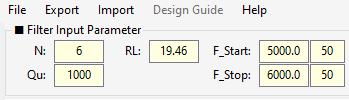
   
  <em>그림 8-1: CMW2026 메뉴바 전체 구성</em>

---

## 8.2 File 메뉴 (프로젝트 관리)

File 메뉴는 현재 작업 중인 프로젝트의 생명주기를 관리합니다.

### 8.2.1 Save File (저장)
- **단축키**: `Ctrl + S`
- **동작**: 현재 작업 상태를 CSV 파일로 저장합니다. 이미 저장된 경로가 있다면 덮어쓰고, 처음 저장하는 경우 파일 탐색기가 열립니다.

  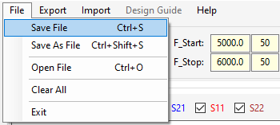
   
  <em>그림 8-2: Save File 저장 창</em>

### 8.2.2 Save As File (다른 이름으로 저장)
- **단축키**: `Ctrl + Shift + S`
- **동작**: 현재 상태를 새로운 파일명으로 저장합니다. 기존 파일은 그대로 유지됩니다.

  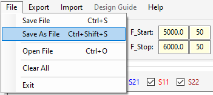
   
  <em>그림 8-3: Save As File 저장 창</em>

### 8.2.3 Open File (열기)
- **단축키**: `Ctrl + O`
- **동작**: 저장된 프로젝트 CSV 파일을 불러옵니다. 불러오기가 완료되면 자동으로 **Filter 모드**로 전환되며 파형이 갱신됩니다.

  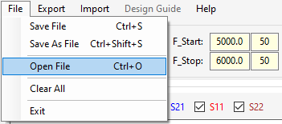
   
  <em>그림 8-4: Open File 파일 열기 창</em>

### 8.2.4 Clear All (전체 초기화)
- **동작**: 모든 매트릭스, Goals, 마커, TZ 데이터를 초기화하고 프로그램 실행 직후 상태로 되돌립니다.
- **주의**: 실행 전 확인 대화상자가 표시되며, 이 작업은 **되돌릴 수 없습니다.**

  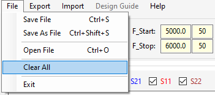
   
  <em>그림 8-5: Clear All 확인 대화상자</em>

### 8.2.5 Exit (종료)
- **동작**: 프로그램을 안전하게 종료합니다.

  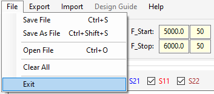
   
  <em>그림 8-6: Exit 버튼 클릭 (또는 창 닫기)</em>

!!! note "프로젝트 CSV 파일의 내부 구조"
    프로젝트 파일은 메모장으로 열어볼 수 있으며, 다음과 같이 섹션(`[ ]`) 별로 구조화되어 있습니다.
    
    

      
       
      <em>그림 8-7: 프로젝트 CSV 파일 내부 구조</em>
    

    
    - `[Parameters]`: 기본 파라미터 및 화면 설정
    - `[Target Matrix]`: 커플링 매트릭스 값
    - `[Optimization Goals]`: 최적화 목표 데이터
    - `[Synthesize TZ]`: 전송 영점 주파수 목록
    - `[SParam Markers]`, `[GD Markers]`: 마커 데이터

---

## 8.3 Export 메뉴 (데이터 내보내기)

설계된 데이터를 외부 파일로 추출하여 보고서 작성이나 다른 시뮬레이터 연동에 사용합니다.

  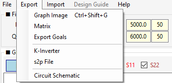
   
  <em>그림 8-8: Export 메뉴 드롭다운</em>

### 8.3.1 Graph Image (그래프 이미지 저장)
- **단축키**: `Ctrl + Shift + G`
- **동작**: 현재 화면의 그래프와 마커 테이블 등을 하나의 이미지 파일(.png, .jpg, .bmp)로 저장합니다. 함께 저장되는 `.txt` 파일에는 설계 파라미터 정보가 기록됩니다.

  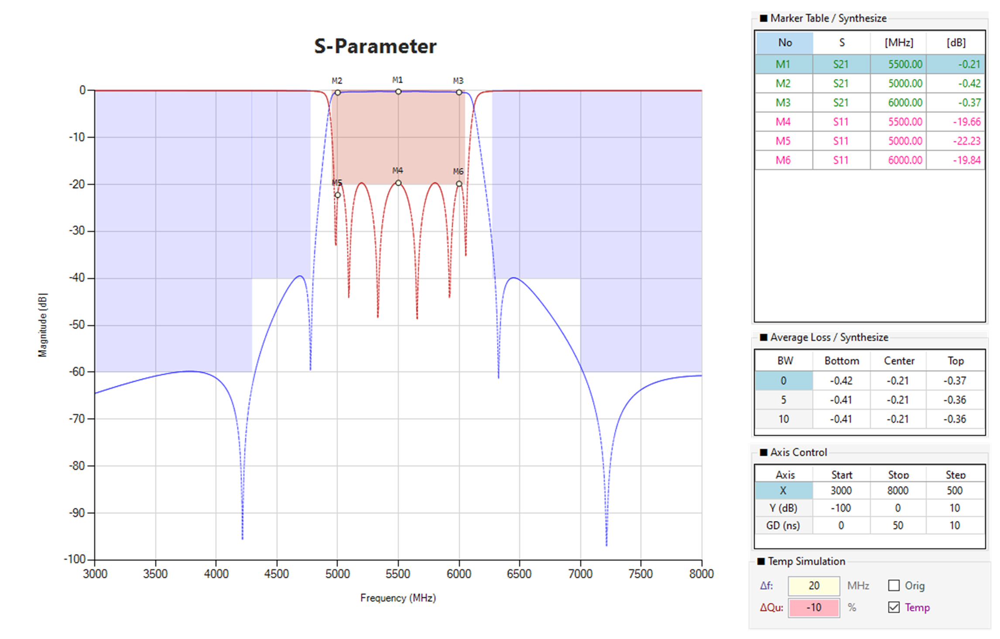
   
  <em>그림 8-9: Graph Image 저장 창</em>

### 8.3.2 Matrix (매트릭스 CSV 내보내기)
- **동작**: 커플링 매트릭스 데이터만 별도의 CSV 파일로 추출합니다. Lock 상태도 함께 저장됩니다.

  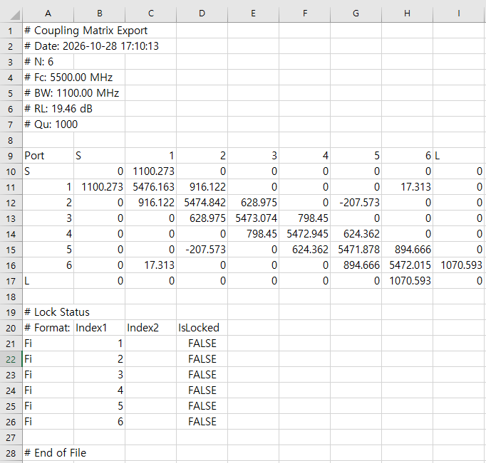
   
  <em>그림 8-10: Matrix CSV 저장 창</em>

### 8.3.3 Export Goals (목표 마스크 내보내기)
- **동작**: Optimization Goals 테이블의 데이터를 CSV 파일로 저장합니다. 다른 프로젝트에 목표 마스크를 이식할 때 유용합니다.

  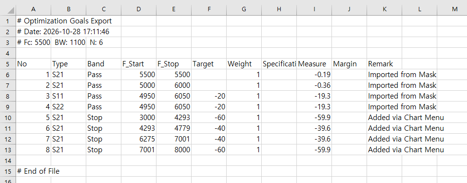
   
  <em>그림 8-11: Export Goals 저장 창</em>

### 8.3.4 K-Inverter (K-인버터 변환)
- **동작**: 커플링 매트릭스(CBW)를 회로 설계에 직접 사용할 수 있는 임피던스 인버터(K) 값으로 변환하여 CSV로 저장합니다.

  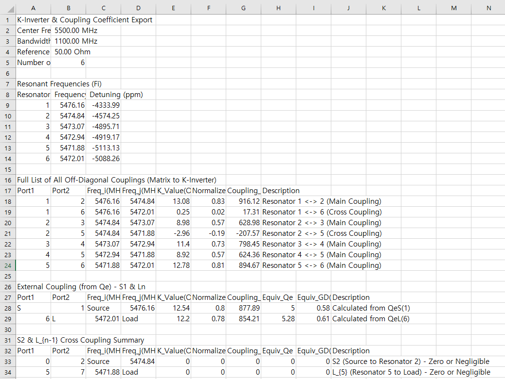
   
  <em>그림 8-12: K-Inverter CSV 저장 창</em>

### 8.3.5 s2p File (S-파라미터 내보내기)
- **동작**: 현재 매트릭스 또는 Synthesize 파형을 Touchstone(`.s2p`) 포맷으로 저장합니다. CST, HFSS, ADS 등 상용 툴에서 바로 불러올 수 있습니다.

  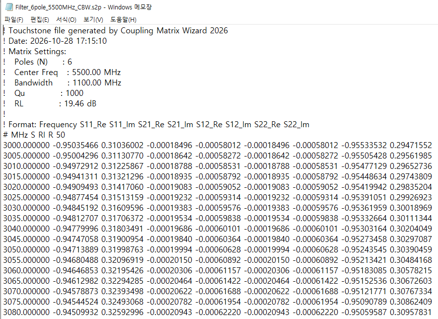
   
  <em>그림 8-13: s2p Export 창 (CBW/Synthesize 선택 및 파일 저장)</em>

### 8.3.6 Circuit Schematic (회로 개략도)
- **동작**: 매트릭스 기반의 필터 회로 토폴로지를 이미지 파일로 저장합니다.

  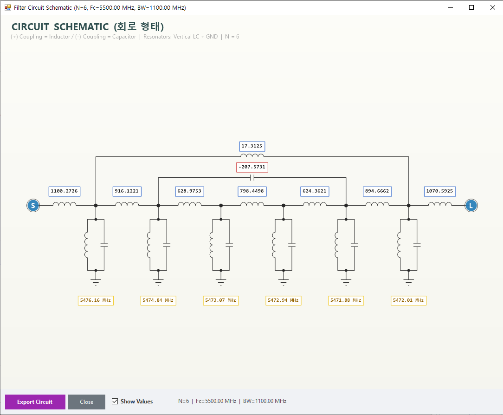
   
  <em>그림 8-14: Circuit Schematic 창</em>

---

## 8.4 Import 메뉴 (데이터 불러오기)

외부에서 생성된 데이터를 CMW2026으로 가져옵니다.

  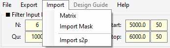
   
  <em>그림 8-15: Import 메뉴 드롭다운</em>

### 8.4.1 Matrix (매트릭스 CSV 불러오기)
- **동작**: Export → Matrix로 저장했던 매트릭스 CSV를 불러와 현재 프로젝트의 매트릭스만 교체합니다. (Goals, 마커 등은 유지됨)

  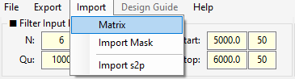
   
  <em>그림 8-16: Matrix CSV Import 파일 열기 창</em>

### 8.4.2 Import Mask (목표 마스크 불러오기)
- **동작**: 고객사에서 받은 스펙 마스크(CSV)를 불러와 Optimization Goals 테이블에 자동으로 채웁니다.

  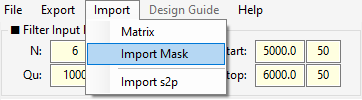
   
  <em>그림 8-17: Import Mask 파일 열기 창</em>

### 8.4.3 Import s2p (외부 s2p 오버레이 비교)
- **동작**: 외부 s2p 파일을 현재 그래프에 **오버레이(점선)** 로 표시하여 Compare 목적으로 사용합니다.
- **특징**:
  - Import 후 **Compare** 체크박스가 그래프 상단에 표시됩니다.
  - Compare S11/S21/S22가 점선으로 오버레이됩니다.
  - Compare 전용 마커(CM1, CM2, ...)를 그래프 우클릭 → **Add MK** → **Compare S11/S21/S22**로 추가할 수 있습니다.
  - 기존 마커(M1, M2, ...)와 완전히 분리되어 관리됩니다.
- **해제**: 그래프 우클릭 → **Clear Compare Markers**로 Compare 마커만 삭제할 수 있습니다. Compare 파형 자체는 다시 Import s2p를 실행하면 갱신됩니다.

  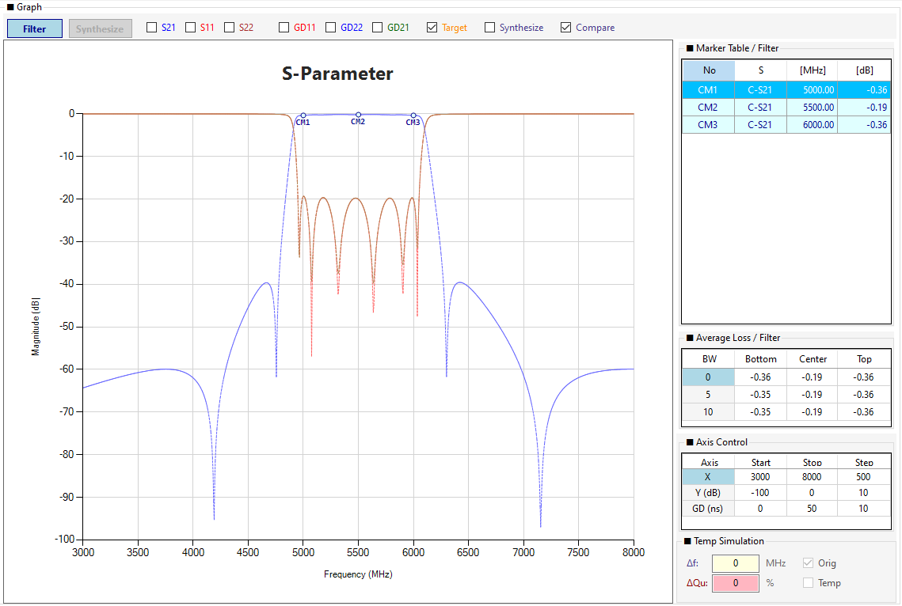
   
  <em>그림 8-18: Import s2p 오버레이 비교 화면</em>

